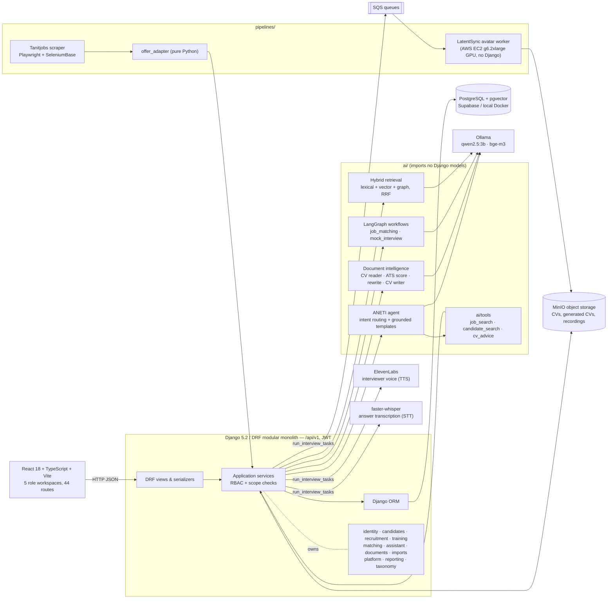
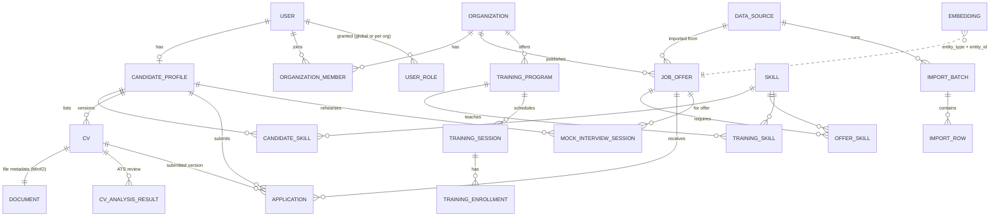

# Mahara Match: 15-minute jury defense outline

Generated 2026-11-08 from the code on branch `fixes/demo-fixes` (including uncommitted work).
Every claim carries a status:

- **IMPLEMENTED**: the code exists and can be reached through the UI, the API or a command, usually with tests.
- **PARTIAL**: it works, but with a documented gap.
- **PLANNED**: it exists only in docs, empty folders or the roadmap. Planned items appear only on slide 15.

**Measured for this outline** (commands are in Appendix A):

- Size: 619 backend tests collected; 57 frontend `test(` calls in 18 files; about 22.6k lines of Python (excluding migrations and tests); about 10.9k lines of Python tests; about 8.1k lines of TS/TSX.
- Structure: 14 Django apps, 12 of them with code; 48 concrete models; 44 frontend routes.

The tests were **collected, not run**, for this outline.

**Time budget:** 890 s (14 min 50 s), within the 15 minutes. The demo is the full jury video (205 s, not cut);
the other slides sum to 685 s. Two visual slides (7b RAG knowledge base, 10b interview on AWS) were added and other
slides shortened to make room. Backup slides B1–B3 follow the conclusion and are for Q&A only (untimed).

| # | Slide | Time |
|---|---|---|
| 0 | Title | 10 s |
| 1 | Context & problem | 50 s |
| 2 | Objectives | 35 s |
| 3 | Users, roles, use cases | 50 s |
| 4 | Global architecture | 60 s |
| 5 | Tech stack & choices | 30 s |
| 6 | Data model | 40 s |
| 7 | Feature: ATS CV review & generation | 60 s |
| 7b | The RAG knowledge base | 35 s |
| 8 | Feature: hybrid + graph job matching | 35 s |
| 9 | Feature: ANETI AI advisor | 45 s |
| 10 | Feature: AI mock interview | 30 s |
| 10b | Mock interview on AWS (avatar pipeline) | 40 s |
| 11 | AI part: constraints & workarounds | 45 s |
| 12 | Demo (video) | 205 s |
| 13 | Difficulties & solutions | 35 s |
| 14 | Results & limits | 40 s |
| 15 | Perspectives | 25 s |
| 16 | Conclusion | 20 s |
| B1–B3 | Backup: ATS formula, evaluation limits, privacy rules | Q&A only |

---

## Slide 0: Mahara Match

- **Time:** 10 s
- **Bullets:** Mahara Match: an AI-assisted employment platform for Tunisia · team names · supervisor · university · date
- **Visual:** the landing page `/` as a full-bleed screenshot, with the logo.
- **Speaker notes:** "Good morning. We are presenting Mahara Match, a platform that connects
  job seekers, employers, training providers and the ministry, with a local AI advisor."
- **Sources:** `frontend/src/pages/Landing.tsx`

---

## Slide 1: Context & problem

- **Time:** 50 s
- **Bullets:**
  - Profiles and job offers don't match well
  - Practical, non-diploma skills are undervalued
  - Repetitive manual hiring processes
  - No application tracking and no analysis of why candidates fail
- **Visual:** four icons, one per cause. Below them, the problem statement quoted in French:
  *"Comment améliorer le parcours d'accès à l'emploi en Tunisie… ?"*
- **Speaker notes:** "The specification names four causes of the difficulty of finding a job in
  Tunisia. Candidate profiles and offers don't match. Practical skills that don't come from a
  diploma are undervalued. Many steps are manual and repetitive. Candidates rarely know where
  their application stands or why it failed. The problem statement is how to improve access to
  employment for job seekers, employers and support structures, given the diversity of profiles
  and market needs. One principle guided everything we built: the platform automates repetitive
  work, but the final decision always stays with the candidate or the employer. The AI recommends
  and explains. It never decides."
- **Sources:** Cahier de charge, physical p. 2 ("Causes", "Problématique", "La décision finale reste…")

---

## Slide 2: Objectives

- **Time:** 35 s
- **Bullets:**
  - One platform for five actors → identity, organizations, RBAC
  - Explainable candidate/offer matching → hybrid + graph retrieval
  - ATS-friendly CV improvement → ATS review + CV generation
  - Links to training → missing skill → training program
  - Assistant in the user's language → ANETI agent (EN/FR/AR)
- **Visual:** a two-column table, "Spec objective (p. 2)" → "Module that delivers it" (the bullets above).
  Grey out the two spec items that are not done: Tunisian-dialect chatbot and forum.
- **Speaker notes:** "The preliminary solution in the specification lists six objectives. Each row
  shows the module that delivers it. We're honest about the two greyed rows. Tunisian dialect is
  not supported yet: the agent understands English, French and Arabic. The interview forum was
  moved after the MVP. We also added one objective that wasn't in the original list: an AI mock
  interview, because preparing for interviews is where candidates feel least supported."
- **Sources:** PDF p. 2 (Solution préliminaire); `docs/architecture/open_questions.md` Q04 (community post-MVP), Q31 (dialect open)

---

## Slide 3: Users, roles and use cases

- **Time:** 50 s
- **Bullets:**
  - Five human roles plus one AI actor
  - Candidates are active at once; recruiters and training providers wait for admin verification
  - Permissions are per role and per organization
  - Applying discloses identity only to that organization
- **Visual:** six cards (icon, role, three use cases); the AI agent card is dark.

  | Role | What they do in the app |
  |---|---|
  | Candidate | Profile and CVs with ATS review; search offers, Easy Apply, track applications; training, assistant, mock interviews |
  | Recruiter | Company page, publish and edit offers; applications pipeline and interviews; discover opted-in candidates, assistant |
  | Training manager | Programs and the skills they teach; sessions and enrollments; provider organization |
  | Ministry manager | Offers, applications, hires and active programs per governorate; hire rate (% of applications); skill gap: offers needing a skill vs programs teaching it. Demo counts, not approved KPIs |
  | Admin | Verify organizations and onboarding requests; accounts and roles; reference data, imports, audit log |
  | **ANETI advisor (AI agent, not a human role)** | Job recommendations with missing skills and training; CV advice from the ATS analysis; for recruiters, opted-in profiles and their own offers |

- **Speaker notes:** "Five human roles and one AI actor. Candidates build their profile and CVs, get an ATS review, search and apply to offers, track applications, enroll in training and rehearse interviews. Recruiters publish offers, run the application pipeline and interviews, and discover candidates who opted in. Training managers publish programs and sessions and manage enrollments. The ministry manager sees offers, applications, hires and programs per governorate, the hire rate, and the gap between skills offers ask for and skills programs teach; these are demo counts, not approved KPIs. Administrators verify organizations and manage accounts, reference data, imports and the audit log. The ANETI advisor is the system's AI agent, not a sixth account type. Name and e-mail go only to the organization a candidate applies to."
- **Sources:** `frontend/src/App.tsx` (routes /candidat, /recruteur, /formation, /ministere, /admin);
  `backend/apps/identity/models/roles.py`; decisions log 2026-10-08 (onboarding); Q22; Q19/Q28; ADR 0001;
  `backend/apps/reporting/README.md`, `frontend/src/pages/ministere/` and decisions log 2026-11-07 (ministry indicators)

---

## Slide 4: Global architecture

- **Time:** 60 s
- **Bullets:**
  - A modular monolith: Django/DRF with 12 domain apps
  - Layers: API → service → ORM; AI code never touches the database
  - Local LLM and embeddings through Ollama
  - Separate processes for scraping and interview video
- **Visual (Mermaid; only components that exist in the code):**



- **Speaker notes:** "This is the real architecture, drawn from the code. The frontend is a React
  single-page app with one workspace per role. It talks to one Django REST backend under
  `/api/v1` with JWT authentication. The backend is a modular monolith: each business domain
  is a Django app that owns its tables and exposes services, and every rule and permission check
  lives in those services. The AI code is in a separate `ai/` package. It never imports Django
  models: the agent calls tools, the tools call services, and the services enforce scope. The
  models run locally in Ollama: Qwen 2.5 3B for text and bge-m3 for embeddings, stored in
  PostgreSQL with pgvector. Two parts run outside the web process. One is the job-offer scraper: we tested it on one
  Tanitjobs results page, and it imported correctly. The other is the LatentSync worker that renders
  the interviewer avatar; we ran it on an AWS EC2 g6.2xlarge GPU instance, reached through SQS queues
  and object storage."
- **Sources:** `backend/config/urls.py`; `docs/architecture/overview.md` (dependency paths);
  `ai/workflows/job_matching.py`, `ai/workflows/mock_interview.py` (LangGraph `StateGraph`);
  `ai/retrieval/hybrid/retriever.py`; `ai/llm/providers/ollama.py`; `pipelines/ingestion/base_scraper.py`;
  `pipelines/interviews/worker.py`; `backend/apps/assistant/services/interview_queue.py`; `docker-compose.yml` (MinIO)

---

## Slide 5: Tech stack and why

- **Time:** 30 s
- **Bullets:**
  - Each choice has a recorded reason
  - Prefer what's already in PostgreSQL over adding a new service
  - Everything AI runs locally, with no paid LLM API
- **Visual:** a table.

  | Layer | Choice | Alternative not taken | Reason (source) |
  |---|---|---|---|
  | Backend | Django 5.2 + DRF, modular monolith | Microservices (named in PDF p. 10) | One schema authority, simpler for an MVP team; heavy jobs can still run as workers (Q01) |
  | Auth | `AbstractUser` + custom RBAC + JWT (simplejwt) | Separate identity provider | Role + organization scoping (Q07, G01) |
  | Database | PostgreSQL (Supabase) | n/a | Source requirement: PostgreSQL is authoritative (DM §1) |
  | Vectors | pgvector in the same DB | Dedicated vector DB, Neo4j | Scope pre-filter in SQL; Neo4j only if traversal needs it (Q14) |
  | LLM | `qwen2.5:3b` via Ollama | Cloud LLM API | Small enough for our PC (GTX 1650, 20 GB RAM); local and free (decisions log 2026-11-06) |
  | Embeddings | bge-m3 (1024 d) | — | Small enough for the same PC; multilingual FR/AR/EN (`.env.example`) |
  | Agent graph | LangGraph | Hand-written state machine | Checkpointed interview steps (`ai/workflows/`) |
  | Frontend | React 18 + TS + Vite + Tailwind 4 | — | Team decision 2026-09-25 (Q25) |
  | Files | MinIO (S3 API, boto3) | Files on disk | Original files out of the DB (DM §5) |
  | Tooling | uv, Ruff, mypy, pytest | — | Team defaults (CONTEXT.md) |

- **Speaker notes:** "Each choice has a recorded reason. Instead of the microservices named in the specification, a modular monolith: one schema and one deployment, with heavy jobs in separate workers. Vectors live in pgvector inside PostgreSQL, so every search filters by permissions in SQL before ranking. Qwen 2.5 3B and bge-m3 run locally because our PC has a GTX 1650 and 20 GB of RAM; bge-m3 also covers French, Arabic and English. No CV leaves the machine."
- **Sources:** `pyproject.toml`; `frontend/package.json`; `docs/architecture/open_questions.md` Q01, Q07, Q14, Q25;
  decisions log 2026-09-21, 2026-11-06; `.env.example` lines 39–45

---

## Slide 6: Data model

- **Time:** 40 s
- **Bullets:**
  - 48 models in 11 domain apps, UUID keys everywhere
  - One shared skill reference for candidates, offers and training
  - Append-only application status history, soft deletion
  - Embeddings are a derived index, not a source of truth
- **Visual (Mermaid ER, core entities only, from the Django models):**



- **Speaker notes:** "The schema is defined by Django migrations, and there are 48 models. The key
  design point is in the middle: one skill table shared by candidates, offers and training
  programs. Because of that, the 'missing skill to training' link is a simple join, and the graph
  part of retrieval needs no graph database. An application points to the exact CV version that
  was submitted, and its status history is append-only. Imported offers keep where they came
  from: a source, a batch and one row per scraped offer. Embeddings sit to the side, keyed by
  entity type and ID. They are a derived index that can be rebuilt, never the source of truth."
- **Sources:** `backend/apps/*/models/` (class list); `backend/apps/matching/models/embeddings.py`;
  `backend/apps/recruitment/models/application_status_history.py`; `mahara_match_data_modeling.md`

---

## Slide 7: ATS CV review and generation (IMPLEMENTED)

- **Time:** 60 s
- **Bullets:**
  - The score is plain deterministic code, not LLM output
  - Two scores: ATS readiness and role fit, by role and level
  - The 3B model only splits sections and rewrites bullets
  - Every model output is checked against the CV's facts
  - Generates an ATS-friendly CV (PDF/DOCX), saved as a new version
- **Visual:** a screenshot of `/candidat/cv` with an analysis open (score breakdown + issues +
  one rewrite). Next to it, the code snippet `ai/document_intelligence/ats/rewrite.py:1-6`, the docstring:
  *"Code rejects any output with a number, role skill or name that is absent from the source
  text… retries once cooler, then returns only a rule-based suggestion."*
- **Speaker notes:** "This is the CV review. The candidate picks a target role, Data Engineer or
  Software Engineer, and a level: intern, junior or mid. The scores come from deterministic
  code: PDF parseability, layout risks such as multiple columns or tables, sections, content, and
  skill coverage weighted by tier, with more credit when a skill is backed by evidence. The 3B
  model has two narrow jobs: split one section into entries, and rewrite one bullet at a time.
  Every output is checked. If the rewrite adds a number, a tool or a company that is not in the
  original, it is rejected, retried once at a lower temperature, then replaced by a rule-based
  suggestion. Finally the candidate can generate a clean CV in PDF or Word, and it is saved as a
  new CV version only if they confirm."
- **Sources:** `ai/document_intelligence/ats/analysis.py` (FORMAT_PENALTIES, `analyze_cv`);
  `ats/roles/{data_engineer,software_engineer}.yaml`; `ats/levels.yaml`; `parsing/section_extraction.py`
  (JSON schema, verbatim check, `PARSER_VERSION` cache); `ats/rewrite.py`; `generation/cv_writer.py`;
  `backend/apps/candidates/services/cv_review.py`; decisions log 2026-11-06
- **Status note:** English CVs only. Other languages get a clear rejection (Q34 open).

---

## Slide 7b: The RAG knowledge base (IMPLEMENTED)

- **Time:** 35 s
- **Bullets:**
  - One knowledge base in PostgreSQL; no separate graph database (Neo4j was not needed)
  - Nodes: published offers, active training programs, opted-in limited profiles, canonical skills, organizations
  - Edges: the link tables (`offer_skills`, `training_skills`, `candidate_skills`) and organization keys
  - Each node also becomes a text document and a bge-m3 vector (1024 d) in `embeddings`
  - `index_retrieval` builds the vectors and prunes what is no longer visible
- **Visual:** knowledge graph schema (Organization -publishes/provides-> Job offer / Training program;
  Job offer -requires-> Skill; Training program -teaches-> Skill; Candidate profile -has-> Skill), beside the
  three stored views of each node (graph, document, vector) and the `index_retrieval` command.
- **Speaker notes:** "Retrieval reads one knowledge base, kept in PostgreSQL. Its nodes are rows we already have:
  published offers, active training programs, opted-in limited candidate profiles, organizations and canonical
  skills. Its edges are the link tables: an offer requires skills, a program teaches skills, a candidate has
  skills. Each node is also written as a text document, and that document becomes a bge-m3 vector in the
  embeddings table. The index_retrieval command builds them and prunes anything no longer visible. We needed
  no separate graph database."
- **Sources:** `backend/apps/matching/management/commands/index_retrieval.py` (what is indexed, `--prune`);
  `backend/apps/matching/models/embeddings.py` (`entity_type`, `entity_id`, `model_name`, vector);
  `backend/apps/recruitment/services/retrieval_scope.py` (`offer_documents`, `offer_ids_for_skills`);
  `backend/apps/training/services/retrieval_scope.py` (`program_documents`, `programs_teaching`);
  `backend/apps/matching/services/retrieval.py` (`graph_ranking`); `backend/apps/matching/README.md`
  ("a minimal relational graph over existing tables, not a graph database"); `docs/ai/architecture.md` (Neo4j only if needed)

---

## Slide 8: Hybrid + graph job matching (IMPLEMENTED, evaluated on synthetic data)

- **Time:** 35 s
- **Bullets:**
  - Graph: skills named in the question rank first; profile skills only break ties
  - Fused with reciprocal rank fusion (k = 60)
  - Every method searches only what the caller may see
  - Explains matched and missing skills
  - If Ollama is down, falls back to word overlap + graph
- **Visual:** a results table from `backend/apps/matching/README.md` (24 cases, 2026-10-15):

  | Mode | MRR | NDCG@5 |
  |---|---:|---:|
  | Word-overlap baseline | 0.714 | 0.608 |
  | Hybrid (overlap + vector) | 0.873 | 0.742 |
  | Hybrid + graph | **0.915** | **0.819** |

  Plus a small diagram: question → [overlap | vector | graph] → RRF → top 5 offers → missing skills → ≤2 training programs.
- **Speaker notes:** "Matching runs three rankings over that knowledge base: words shared with the question over the documents, bge-m3 similarity over the vectors, and the graph, where offers requiring the skills named in the question rank first and the candidate's own skills break ties. Reciprocal rank fusion merges them. On our 24 French and Arabic test questions, vectors raised NDCG@5 from 0.61 to 0.74, and the graph to 0.82. The data is small and synthetic and the graph is favoured by how the labels were built, so this shows the mechanism, not real-world quality."
- **Sources:** `ai/retrieval/hybrid/retriever.py` (RRF_K = 60, legs); `ai/retrieval/lexical/scoring.py`;
  `backend/apps/matching/services/retrieval.py`; `ai/graphrag/missing_skill_training.py`;
  `backend/apps/matching/README.md` §Results, §Evaluation limits; `retrieval_cases.py`

---

## Slide 9: The ANETI AI advisor (IMPLEMENTED for candidates and recruiters)

- **Time:** 45 s
- **Bullets:**
  - Keyword intent routing in EN/FR/AR, limited to the caller's role
  - Tools call services; the agent itself has no database access
  - Replies come from templates that are always grounded, with citations
  - LLM rewording is kept only if it passes the grounding check
  - Recruiter history stores profile IDs only
- **Visual:** the pipeline: question (EN/FR/AR) → detect language → keyword route for the caller's role →
  one tool → template reply + citations → optional LLM rewording kept only if grounded. A branch shows
  "not supported → says what it can do, no tool runs". Tool cards: candidate `search_jobs_for_candidate`,
  `get_cv_advice`; recruiter `search_candidates`, `search_own_offers`. Beside it, a crop of the
  `/candidat/assistant` screenshot.
- **Speaker notes:** "The ANETI advisor is the platform's AI agent. With a 3B model we don't let the LLM choose the tool. We detect the language, then keyword patterns in English, French and Arabic pick one route allowed for the caller's role. Anything else gets a reply saying what the agent can do, and no tool runs. Candidates have two tools: job search, and CV advice from their latest ATS analysis. Recruiters have two: opted-in profiles and their own offers. Tools call the same services as the screens, with the same permission checks. The reply is a template filled with that evidence, with citations; for English candidate replies an LLM rewording is kept only if it adds nothing new. Recruiter history keeps profile IDs only."
- **Sources:** `ai/agents/intents.py` (`detect_language`, `route_request`); `ai/agents/anetai.py` (`_routes`,
  `_stays_within_evidence`, `_reword`, trace allow-list); `ai/workflows/job_matching.py` (`build_agent_graph`);
  `ai/agents/templates.py` (`unsupported_reply`, `cv_advice_reply`);
  `ai/agents/service.py` (`citations_for`); `ai/tools/`; `backend/apps/assistant/services/agent_access.py`;
  `docs/ai/architecture.md` §Scoped retrieval; Q29
- **Status note:** CV advice intent (`ai/tools/cv_advice.py`) is uncommitted work on this branch.
  Tunisian dialect is answered as unsupported (Q31).

---

## Slide 10: AI mock interview (IMPLEMENTED; avatar rendered on an AWS EC2 g6.2xlarge GPU)

- **Time:** 30 s
- **Bullets:**
  - Three questions generated from the offer and the candidate's profile
  - ElevenLabs voice + LatentSync lip-synced avatar (AWS GPU)
  - faster-whisper transcribes; follow-up only for vague answers
  - Per-answer coaching that quotes the candidate's own words
  - Answer video stays in the browser; only audio is uploaded
- **Visual:** a frame of `/candidat/entretiens-blancs/:id` taken from the jury video (the 9:16 interviewer
  card + camera preview; the screenshot set has no mock-interview shot). Below it, the flow: LangGraph `prepare → questions → decide_next → (followup | next) → evaluate`.
- **Speaker notes:** "The candidate picks an offer and rehearses. A LangGraph workflow writes three questions from the offer and the candidate's profile, and a lip-synced avatar asks them with an ElevenLabs voice. The candidate answers on camera, but the video stays in the browser; only the audio is uploaded and transcribed with faster-whisper. A vague answer gets one follow-up, and the code decides when the interview ends. Each answer then gets coaching that quotes the candidate's own words."
- **Sources:** `ai/workflows/mock_interview.py` (graph, validators, `< 3` MAIN answers rule);
  `ai/llm/providers/interview.py` (one call per answer); `pipelines/interviews/` (worker, LatentSync, queue);
  `ai/speech/audio.py`, `ai/speech/faster_whisper.py`, `ai/speech/elevenlabs.py`; `frontend/src/components/interview/`; decisions log 2026-10-11, 2026-11-08;
  commits 65bf99f, 35a5134, c5eda47

---

## Slide 10b: Mock interview on AWS: how the avatar video is made (IMPLEMENTED)

- **Time:** 40 s
- **Bullets:**
  - Task runner: LangGraph + qwen2.5:3b questions, ElevenLabs speech stored in MinIO
  - Coordinator publishes one video job per question to Amazon SQS
  - Intro + Q1 on a priority queue; Q2 + Q3 on a background queue; results on a status queue
  - EC2 g6.2xlarge (NVIDIA L4): LatentSync lip-syncs an avatar clip to the audio at 15 FPS
  - Output checked (size, SHA-256, duration) before the API streams it to the browser
- **Visual:** architecture: Browser → Django API + PostgreSQL → task runner (LangGraph + Qwen, ElevenLabs,
  faster-whisper) → MinIO; coordinator → SQS priority / background queues → EC2 g6.2xlarge LatentSync worker
  (no Django) → MinIO → status queue → coordinator → API streams the MP4. Follow-up and closing have no GPU job.
- **Speaker notes:** "Here is how the avatar video is made. Our task runner writes each question and turns it into
  speech with ElevenLabs, stored in MinIO. A coordinator sends one video job per question to Amazon SQS: the
  introduction and first question on a priority queue, the others on a background queue. On an EC2 g6.2xlarge
  with an NVIDIA L4, the LatentSync worker lip-syncs an avatar clip to that audio and uploads the video. It
  reports on a status queue; the coordinator checks size, checksum and duration, and the API streams the video.
  The worker has no Django and no database access."
- **Sources:** `backend/apps/assistant/services/interview_jobs.py` (`video_intent`: intro/q1 required, priority);
  `backend/apps/assistant/services/interview_queue.py` (`configured_queues`, `publish_one`);
  `backend/apps/assistant/services/interview_media.py` (`stream_avatar`); `pipelines/interviews/worker.py`
  (MinIO/SQS worker, `VisibilityLease`), `pipelines/interviews/latentsync.py` (15 FPS), `pipelines/interviews/queue.py`;
  management commands `run_interview_tasks`, `coordinate_interviews`; `docs/deployment/mock_interviews.md`

---

## Slide 11: AI part: constraints and how we worked around them

- **Time:** 45 s
- **Bullets:**
  - Constraints: a 3B local model, no fine-tuning, a GTX 1650 + 20 GB RAM
  - Deterministic code decides; the LLM only formats
  - One small task per call, with JSON-schema output
  - Verify every output; fall back on failure
  - Measure before claiming
- **Visual:** a two-column table, "Problem with a 3B model" → "What we built (where)".

  | Problem observed | Workaround | Code |
  |---|---|---|
  | Unstable scores | ATS score is pure code; weights in YAML | `ats/analysis.py`, `ats/levels.yaml` |
  | Invented numbers/tools | Verbatim / fact check, cooler retry, rule fallback | `ats/rewrite.py`, `parsing/section_extraction.py` |
  | Malformed JSON | Ollama JSON-schema constrained output + validator | `section_extraction.py` SCHEMA, `mock_interview.py` validators, c5eda47 |
  | Long prompts confuse it | One section / one bullet / one answer per call | `rewrite.py`, `interview.py` evaluate (35a5134) |
  | Bad tool choice | Keyword routing before any LLM | `ai/agents/intents.py` |
  | Hallucinated replies | Grounded templates; rewording kept only if it passes | `ai/agents/anetai.py` |
  | Model decides to stop too early/late | The answer count decides | `mock_interview.py` (65bf99f) |
  | Ollama outage | Vector leg skipped, recorded in the trace | `retriever.py` `vector_unavailable` |
  | Repeated cost | Parse cached by document checksum + parser version | `PARSER_VERSION` |

- **Speaker notes:** "Our constraint was a 3-billion-parameter model on a GTX 1650 with 20 GB of RAM, and no fine-tuning: we had neither the labelled data nor the GPU budget. Small models invent facts, break JSON, get lost in long prompts and make poor control decisions. Our answer: code decides, the model formats. Scores and routing are deterministic. Each call does one small task with JSON-schema output and is then verified; if verification fails, we fall back to a rule-based result instead of a hallucination."
- **Sources:** as in the table; decisions log 2026-11-06; `docs/ai/architecture.md` §Providers and evaluation

---

## Slide 12: Demo

- **Time:** 205 s
- **Bullets:** none. This slide only shows the title "Demo" and the role chips.
- **Visual:** the recorded jury video (`demo-jury.mp4`, French captions, 3 min 25 s), embedded in the
  slide and played in full. There is no live demo.
- **Speaker notes:** introduce it in one sentence, then let it play; the captions carry the story.
  Don't explain the code here.
- **Sources:** `video/demo-assets/README.md`

---

## Slide 13: Difficulties and solutions

- **Time:** 35 s
- **Bullets:**
  - Playwright's event loop blocks Django ORM calls → import runs in two phases
  - A 3B model's unreliable output → schema, checks, fallbacks
  - faster-whisper broke with PyAV 19 → decode samples first
  - A lucky ranking hid an evaluation bug → fixed the overlap ranking, re-measured
  - Privacy versus usefulness → limited profiles, IDs-only traces, ADR 0001
- **Visual:** a table of problem → cause → fix → commit/doc.
- **Speaker notes:** "Five real problems. Playwright keeps an asyncio loop running and Django refuses database calls inside it, so the import collects offers first, then writes them. The small model, covered earlier. A library upgrade broke transcription, so we decode the audio ourselves. Our first evaluation looked good partly by luck; we fixed the ranking, re-measured and kept the lower, honest numbers. And privacy: recruiters search without seeing personal data, settled in a decision record."
- **Sources:** `CLAUDE.md` §Gotchas; commit 146e867; `backend/apps/matching/README.md` "What changed and why";
  `docs/adr/0001-applicant-identity-disclosure.md`; Q19, Q28, Q29

---

## Slide 14: Results and limits

- **Time:** 40 s
- **Bullets:**
  - Five role workspaces wired to a real API
  - 619 backend tests (collected), plus frontend unit tests
  - Retrieval: MRR 0.915, NDCG@5 0.819 (synthetic, 24 cases)
  - Limits: English-only ATS, no Tunisian dialect
  - Limits: small eval set, no reranker, no production deployment yet
- **Visual:** two columns, ✅ What works / ⚠ Limits, plus a small counter strip (619 tests · 48 models · 12 apps · 44 routes).
- **Speaker notes:** "What works: all five roles have screens backed by the API, with role and organization checks, including the full application lifecycle, training enrollment, notifications and an audit log. There are 619 automated backend tests, and the AI features run end to end on a local model. The limits: the ATS review handles English CVs only, and the Tunisian dialect isn't supported yet. Our retrieval numbers come from a small synthetic set, with no reranker and no vector index yet. Ministry indicators are demo counts, not approved KPIs. And nothing has been deployed to production."
- **Sources:** `uv run --frozen pytest --collect-only -q`; `backend/apps/matching/README.md` §Evaluation limits;
  Q31, Q34, Q20; decisions log 2026-11-07 (ministry demo counts)

---

## Slide 15: Perspectives (PLANNED)

- **Time:** 25 s
- **Bullets:**
  - Tunisian dialect: an evaluation set, then routing (Q31)
  - French/Arabic CVs for the ATS review (Q34)
  - Real evaluation data, a reranker, an HNSW index
  - Dagster for scheduled imports, embedding sync, more sources
  - Agent actions with confirmation (apply, enroll); interview forum
- **Visual:** a timeline with three steps: MVP hardening → Tunisian language → scale (Dagster, deployment).
- **Speaker notes:** "Next steps, in priority order. First, Tunisian dialect, but only after an
  evaluation set exists, so the claim can be measured. Second, French and Arabic CVs. Third, better
  retrieval: real labelled data, a reranker and a vector index. Fourth, Dagster to schedule imports
  and keep embeddings in sync; today the folders exist but contain no code. Last, letting the agent
  act, such as applying or enrolling, but always after explicit user confirmation. The tables for
  that already exist."
- **Sources:** `pipelines/dagster/` (empty); `ai/reranking/`, `ai/evaluation/` (empty); `AgentAction` model
  (`backend/apps/assistant/models/records.py`), Q15; Q04 (forum post-MVP); Q21 (fine-tuning gated)

---

## Slide 16: Conclusion

- **Time:** 20 s
- **Bullets:**
  - One platform for the five employment actors
  - Explainable AI that runs on a 3B local model
  - Code decides, the model assists, humans decide
- **Visual:** the three takeaways in large type, then "Thank you. Questions?"
- **Speaker notes:** "To conclude, Mahara Match brings the five actors of the employment journey
  together on one platform. It shows that a small local model can give useful, explainable help
  when deterministic code keeps it in check. And the final decision always stays with people.
  Thank you; we're happy to take your questions."
- **Sources:** slides 2, 11

---

## Backup B1: ATS scoring formula (Q&A only)

- **Bullets:**
  - Six components scored 0–100, combined as a weighted mean; weights depend on the level
  - ATS readiness = parseability, sections, content, length; role fit = skill coverage, evidence
  - Parseability: 100 minus format penalties (multi-column 25, tables 20, text boxes 20, images 10, unusual fonts 10) and missing contacts (e-mail 10, phone 5)
  - Skill coverage: tier weight (core 3, common 2, bonus 1) × evidence (listed only 0.5, used in a bullet 1.0)
- **Visual:** a table of the weights per level.

  | Level | Parseability | Sections | Skill coverage | Evidence | Content | Length |
  |---|---:|---:|---:|---:|---:|---:|
  | Intern | 20 | 14 | 30 | 15 | 13 | 8 |
  | Junior | 20 | 12 | 30 | 18 | 13 | 7 |
  | Mid | 20 | 10 | 30 | 20 | 15 | 5 |

- **Speaker notes:** "The overall score is a weighted mean of six deterministic components. Readiness
  groups parseability, sections, content and length; role fit groups skill coverage and evidence.
  A skill counts more when it is core to the role and when it is used in a bullet, not just listed.
  These weights are a version 1 starting point, to be tuned against a gold CV set (Q26)."
- **Sources:** `ai/document_intelligence/ats/analysis.py` (READINESS, FIT, FORMAT_PENALTIES, CONTACT_PENALTIES, `combine`);
  `ats/profiles.py` (TIER_WEIGHTS); `ats/levels.yaml`

---

## Backup B2: Retrieval evaluation limits (Q&A only)

- **Bullets:**
  - About 12 distinct questions (each Arabic case translates a French one) over 29 documents
  - Synthetic training programs; skill groupings are arbitrary
  - Relevance follows the same skill links the graph uses: hybrid + graph is favoured by construction
  - Labels written by an AI assistant from rules, checked automatically, partly reviewed by a human
  - No reranker, no HNSW index, RRF k = 60 not tuned; no difference is statistically solid
- **Visual:** NDCG@5 by question group (from the README).

  | Group | Baseline | Hybrid | Hybrid + graph |
  |---|---:|---:|---:|
  | Keywords | 0.863 | 0.923 | 0.979 |
  | Semantic | 0.171 | 0.545 | 0.545 |
  | Multi-hop | 0.790 | 0.758 | 0.935 |

- **Speaker notes:** "These numbers show the mechanism works on a small synthetic set. They are not
  evidence of better retrieval on real data. Vectors help on paraphrase questions; the graph helps
  where a skill is named and changes nothing on semantic questions. The next step is real labelled data."
- **Sources:** `backend/apps/matching/README.md` §Results (NDCG@5 by group), §Evaluation limits

---

## Backup B3: Privacy rules (Q&A only)

- **Bullets:**
  - Profiles are private by default (Q19)
  - On opt-in, verified recruiters see a limited view: no name, contacts, birth date or CV (Q19, Q28)
  - Applying or enrolling discloses name, e-mail and limited profile to that organization only; never the phone (ADR 0001)
  - Recruiter agent history keeps profile IDs, ranks and matched skills only (Q29)
  - Retrieval pre-filters by permitted IDs before ranking
- **Visual:** three columns: before applying → after applying → in the assistant.
- **Speaker notes:** "Three rules. Before any application, a recruiter sees at most a limited,
  anonymous profile, and only if the candidate opted in to RECRUITERS or PUBLIC visibility. Applying
  or enrolling is consent toward that one organization: it then sees the name, e-mail and limited
  profile, but not the phone. In the assistant, recruiter replies and traces store only profile IDs,
  ranks and matched skill names."
- **Sources:** `docs/architecture/open_questions.md` Q19, Q28, Q29, Q32; `docs/adr/0001-applicant-identity-disclosure.md`;
  `backend/apps/matching/README.md` (pre-filter)

---

# Appendix A: Verification table

| Feature | Status | Evidence | Tests |
|---|---|---|---|
| Identity, organizations, RBAC, onboarding | IMPLEMENTED | `backend/apps/identity/` | `tests/integration/identity/` |
| Candidate profile, CV versions, documents (MinIO) | IMPLEMENTED | `backend/apps/candidates/`, `documents/` | `tests/integration/candidates/`, `documents/` |
| ATS review, rewrite, CV generation | IMPLEMENTED (EN only) | `ai/document_intelligence/` | `tests/unit/ai/test_ats_analysis.py`, `test_cv_rewrite.py`, `test_section_extraction.py`, `test_cv_generation.py` |
| Offers, Easy Apply, status history, interviews | IMPLEMENTED | `backend/apps/recruitment/` | `tests/integration/recruitment/` |
| Training programs, sessions, enrollments | IMPLEMENTED | `backend/apps/training/` | `tests/integration/training/`, `test_phase3_filters.py` |
| Hybrid + graph retrieval + evaluation | IMPLEMENTED (synthetic eval) | `ai/retrieval/`, `backend/apps/matching/services/` | `tests/integration/matching/` |
| ANETI agent (candidate + recruiter) | IMPLEMENTED; CV-advice intent uncommitted | `ai/agents/`, `ai/tools/` | `tests/unit/ai/test_anetai_routing.py`, `test_anetai_grounding.py`, `tests/integration/matching/test_*agent*.py` |
| Mock interview (LangGraph, faster-whisper STT, ElevenLabs TTS, LatentSync avatar worker) | IMPLEMENTED; avatar worker ran on AWS EC2 g6.2xlarge | `ai/workflows/mock_interview.py`, `pipelines/interviews/` | `tests/unit/pipelines/test_interview_worker.py`, `tests/e2e/test_mock_interview.py` |
| Tanitjobs import | IMPLEMENTED; tested on one results page, which imported correctly | `pipelines/ingestion/`, `backend/apps/imports/` | not inspected |
| Notifications, audit log | IMPLEMENTED | `backend/apps/platform/` | `tests/integration/test_audit_log_coverage.py` |
| Ministry indicators | PARTIAL (demo counts) | `backend/apps/reporting/services/indicators.py` | `tests/integration/reporting/` |
| Agent actions with confirmation | PARTIAL (model + idempotent records only) | `AgentAction`, `assistant/services/records.py` | — |
| Tunisian dialect | PLANNED (Q31) | — | — |
| Dagster, reranker, OCR, Neo4j, community/forum | PLANNED | empty folders | — |

Commands used for the numbers in this file:

```
uv run --frozen pytest --collect-only -q          # 619 tests collected (not run)
grep -c "test(" frontend/tests/*.mjs              # 57 across 18 files (grep count, approximate)
git ls-files '*.py' | grep -v migrations | grep -v '^tests/' | xargs cat | wc -l   # ≈22.6k
grep -c 'path="' frontend/src/App.tsx             # 44 routes
```

---

# Appendix C: Tough jury questions with answers

1. **"Why a 3B local model and not GPT-4 or a cloud API?"**
   Our hardware, cost and privacy. We developed on a PC with a GTX 1650 and 20 GB of RAM, so we chose
   models small enough to run there: qwen2.5:3b for text and bge-m3 for embeddings, which is also
   multilingual (French, Arabic, English). CVs are personal data, and a public employment service may
   not be allowed to send them to a foreign API; a local model runs at no cost per call. We compensated for its weakness in the design: code decides, the model
   only formats, and every output is verified (slide 11). The provider sits behind one adapter
   (`ai/llm/providers/ollama.py`, model from `OLLAMA_MODEL`), so a larger model is a configuration change.

2. **"How do you know your matching or ATS score is any good?"**
   For matching: a 24-case evaluation with MRR, Recall and NDCG, showing the hybrid + graph mode is best
   (0.915 MRR). We also say clearly that it is synthetic and small, and that the labels favour the graph.
   For the ATS: the formula is deterministic and transparent (weights in YAML, a breakdown shown to the
   user). It is presented as improvement feedback, not a hiring verdict (Q26). Its weights are a v1 still
   to be revised against a gold CV set, which we haven't built yet.

3. **"What happens when the LLM hallucinates?"**
   The output is never shown without a check. Section extraction keeps only text that appears verbatim
   in the CV. Rewrites with new numbers, tools or companies are rejected, retried once, then replaced by a
   rule-based suggestion. Agent replies are grounded templates; LLM rewording is kept only if it passes a
   word-level grounding check. Interview excerpts must be copied word for word.

4. **"Why no fine-tuning?"**
   We had no labelled Tunisian employment dataset and no training budget. The specification itself makes
   fine-tuning conditional on data, resources and evaluation (PDF p. 10, Q21). Prompting with checks and
   retrieval gave grounded results without training. Fine-tuning would be justified once real usage data
   and an evaluation set exist.

5. **"How do you protect candidate data?"**
   Profiles are private by default. Recruiters see a limited, anonymous view only on candidate opt-in
   (Q19, Q28). Name and e-mail go only to the organization the candidate applies to (ADR 0001). Agent
   history for recruiters stores profile IDs only (Q29). Interview video never leaves the browser, and
   audio is deleted after a retention window (`INTERVIEW_RECORDING_RETENTION_HOURS`). Retrieval filters by
   permitted IDs before ranking. Every sensitive change writes an audit row (Q33).

6. **"A monolith doesn't scale. Why not microservices?"**
   For an MVP, a modular monolith gives one schema, one deployment and one transaction model, with strict
   domain boundaries enforced through services. The heavy parts already run as separate processes (the
   GPU avatar worker through SQS, and the scraper), so they scale independently without splitting the
   business data (Q01).

7. **"The specification asks for Tunisian dialect. Why isn't it there?"**
   Because we couldn't measure it. Keyword routing works for English, French and Arabic. Arabizi and
   dialect would need an evaluation set first; otherwise we'd be claiming support we can't prove. It is
   recorded as open (Q31) and is our first perspective.

8. **"What exactly did you build yourselves, versus libraries or AI coding tools?"**
   This is a team project. We designed the domain boundaries, the recorded decisions (decisions log,
   ADRs) and the validation and fallback logic. AI coding tools were assistants: we reviewed their
   output, and we own the design and can explain every decision.

---

# Appendix D: Weak points the jury may find, and how to answer them

| Weak point | Honest answer |
|---|---|
| The evaluation is synthetic, small and AI-labelled | "Yes. It validates the mechanism, not real-world quality; the next step is real labelled data." |
| ATS is English-only although users are Tunisian | "Tech CVs in Tunisia are often in English; FR/AR need heading dictionaries and a gold set (Q34)." |
| Ministry dashboard = demo counts | "KPI definitions (numerator, window, privacy threshold) were never approved (Q20); we didn't invent them." |
| No production deployment | "Runs locally end to end, with the avatar worker on an AWS EC2 GPU instance; production deployment needs separate approval and budget." |
| Agent can't act (apply/enroll) | "Intentional: actions need explicit confirmation and the lifecycle (Q15) isn't final. The data model is ready." |
| Several empty folders (`ai/rag`, `pipelines/dagster`…) | "These folders mark planned boundaries from the architecture; we never present them as features." |
