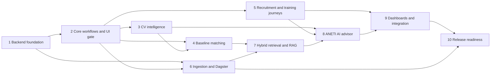

# Mahara Match — Collaborative implementation roadmap

This is a future execution roadmap for five people, not an implementation report.
No feature, migration, pipeline or frontend is created by this document.
Start Phase 1 with the [detailed data/backend plan](phase_01_data_backend.md).
Follow the [team workflow](development_workflow.md) for every PR.

## Sources, decisions and working conventions

- **Business sources:** [data model](../../mahara_match_data_modeling.md) (DM) and
  [preliminary specification](../../Cahier%20de%20charge%20pr%C3%A9liminaire%20PDF.pdf)
  (PDF). PDF references below use physical pages including the cover.
- **Recorded architecture:** [CONTEXT.md](../../CONTEXT.md), [AGENT.md](../../AGENT.md),
  [domain ownership](../architecture/domain_boundaries.md) and the
  [question register](../architecture/open_questions.md).
- **User decisions:** Django/DRF/PostgreSQL modular monolith; all defined relational
  entities in Phase 1; include frontend delivery behind a technology/location gate;
  the ANETI employment advisor is the system AI agent, never a human advisor role.
- **Planning choices:** assignments, file names, merge waves and sequencing below
  organize future work; they do not invent source business rules. No calendar
  estimates or real names are inferred. P1 means Person 1, and similarly for P2–P5.

All code paths below are future targets under existing architectural areas unless
explicitly identified as a gated frontend path. Tables define a task's allowed
change area; other modules require their owner's contract/review first. Unit tests
belong under tests/unit/, database/API collaboration under tests/integration/, and
complete journeys under tests/e2e/. Each task's owner also owns its tests and docs.

Backend API → application service → Django ORM → PostgreSQL.
Agent/LangGraph → tool → application service → ORM.
Dagster → reusable processing → application service for relational reads/writes.
Services can invoke reusable AI capabilities and validate/persist returned results.
Agents/tools cannot import models; capabilities cannot call back into their invoking
services. Object storage stores bytes; vector/Neo4j stores derived projections.

**Frontend notation:** `UI_ROOT` is deliberately unbound until gate F01. P4 must
record exact framework-compatible source, feature and test paths in this roadmap
before any UI task starts. A root frontend/ area is a recommendation for that
decision, not an existing folder or authorization to create it in this docs task.
UI task names below identify required screens/contracts without pretending a stack
has been selected. Backend tasks can complete against API tests while F01 is open;
UI milestones cannot be declared complete. UI consumes the same authorized APIs.

## Phase overview

| Phase | Objective | Person 1 | Person 2 | Person 3 | Person 4 | Person 5 | Main repo areas | Deliverable |
| --- | --- | --- | --- | --- | --- | --- | --- | --- |
| 1 | Relational backend | Users/RBAC, assistant/platform records, integration | Candidates, documents, taxonomy | Recruitment/match records | Organizations/import records, PostgreSQL/CI | Training, taxonomy test support | backend/, tests/, infrastructure/, .github/ | All defined data domains and controlled APIs |
| 2 | Core workflows and UI foundation | Account/access operations | Candidate editing/completeness | Offer publication lifecycle | Organization workflows/UI foundation | Training catalogue lifecycle | backend/apps/, gated UI_ROOT | Authorized account/profile/catalogue journeys |
| 3 | CV intelligence | Access/trace contract | Parse/review/generate integration | ATS and target-offer comparison | Storage/upload/UI | Text extraction/OCR | ai/document_intelligence/, pipelines/document_processing/, backend/ | Candidate-validated CV processing |
| 4 | Baseline search/recommendations | Access/result contracts | Candidate features/evaluation | Search/job matching | Search UI/organization evidence | Training recommendations | matching/, recruitment/, training/, ai/evaluation/ | Explainable PostgreSQL-first recommendations |
| 5 | Participation workflows | Notifications/audit | Candidate application journey | Applications/recruitment/interviews | Employer/provider UI | Enrollment/progression | recruitment/, training/, platform/, gated UI_ROOT | Tracked applications and training participation |
| 6 | Background data work | Source authorization/audit | Taxonomy/quality normalization | Offer reconciliation | Imports/connectors | Dagster scheduling/recovery | imports/, pipelines/, infrastructure/ | Traceable authorized imports and background orchestration |
| 7 | RAG/GraphRAG | Retrieval authorization | CV/profile evidence/evaluation | Hybrid retrieval/reranking | Embeddings/projections/stores | Graph/training context | ai/, pipelines/synchronization/, infrastructure/ | Grounded hybrid retrieval and measured recommendations |
| 8 | ANETI AI advisor | Execution/confirmation records | CV tools | Search/application tools | Agent/LangGraph/chat UI | Training tools/evaluation | ai/agents/, ai/tools/, ai/workflows/, assistant/ | Confirmed, traceable FR/AR/Tunisian assistance |
| 9 | Dashboards/integration | Administration/audit views | Candidate dashboards | Recruitment indicators | Integrated dashboards | Training/ministry aggregates | backend/apps/, tests/e2e/, gated UI_ROOT | Role-specific journeys and approved aggregate reports |
| 10 | Release readiness | Security/access audit | CV/privacy acceptance | API/search performance | Deployment/observability | Pipeline recovery/AI regression | infrastructure/, tests/, .github/, docs/ | Reproducible, tested release candidate |
| Post-MVP | Gated extensions | Moderation/access review | Community/fine-tuning data | Advanced interviews/freelance study | External integration/quantization study | Training assessment/AI evaluation | Existing areas; new schemas only after approval | Separately scoped extension proposals and delivery |

The numbers describe integration milestones, not a requirement for all five people
to wait at every boundary. Start security, CI, fixtures, metrics and documentation
with each feature. Phase 10 consolidates evidence instead of introducing testing late.
Phase 7 follows baseline matching for development; Q02 still decides which milestone
may be labeled MVP. Do not call a baseline-only release the approved MVP by inference.

Phase 4 can start using manually entered candidate data before CV extraction is
complete. Its CV-backed acceptance depends on Phase 3. Phase 5 can proceed without
AI recommendations. Phase 6 connector/scheduler development can proceed alongside
Phases 3–5 once source/offer contracts stabilize. Phase 7 can develop against
synthetic projections before imports finish; integrated recurring synchronization
requires Phase 6. These are contract-based parallel lanes, not alternate schemas.

## Phase 1 — Relational backend foundation

**Objective:** make every defined data domain available without implementing advanced
business workflows. Sources: DM §§1–7, 9; PDF pp. 3–6, 9. The linked detailed plan
contains all 43 entity assignments, exact path rules, operation permissions and gates.

| Task | Responsibility / future paths | Dependencies | Deliverable and validation | Reviewer | Merge |
| --- | --- | --- | --- | --- | --- |
| P01-1A / P01-1B — P1 | Initialize backend/config/, backend/manage.py and identity user/RBAC files; assistant/ and platform/ persistence | G01–G03; organization scope from P4 | Real settings, protected APIs and PostgreSQL constraint/access tests | P4, P2 | W1–W2, W6 |
| P01-2 — P2 | backend/apps/candidates/, taxonomy/, documents/ plus assigned model/API tests | Users, reference/CV gates; target offers for analyses | Candidate/document/reference records and validated scoped CRUD | P5, P3 | W3–W5 |
| P01-3 — P3 | backend/apps/recruitment/ and matching/ persistence | Organizations, users, taxonomy, sources, candidates/CVs | Offer, application/history/interview and result records; no calculation/workflow shortcuts | P2, P4 | W4–W5 |
| P01-4A / P01-4B — P4 | identity organization/member files; imports/; infrastructure/postgres/, infrastructure/docker/, .github/workflows/ci.yaml | Shared identity contract; documents/offers for provenance | Organization/import schema and reproducible database/CI, tested without hand-authored DDL | P1, P3 | W1–W5, W7 |
| P01-5 — P5 | backend/apps/training/; tests/integration/test_taxonomy_consumers.py | Provider organizations, skills, candidate records | Program/session/enrollment/recommendation records with scope/uniqueness tests | P4, P2 | W3 support, W4–W5 |

**Parallel/merge:** follow W0–W7 in [Phase 1](phase_01_data_backend.md). P1/P4
split identity files and serialize migrations; references precede consumers;
import sources precede offers and import rows follow offers. Highest conflict risk:
settings, lockfile, app exports/routes, shared fixtures and same-app migrations.

**Exit:** all 43 definitions reconciled, migrations work from clean and previous
integrated databases, no drift, scoped interfaces tested, Ruff/mypy/pytest and CI
pass. **Deferred:** computed results, lifecycle actions, file processing and UI.

## Phase 2 — Core workflows and UI foundation

**Objective:** turn CRUD into authorized account/profile/catalogue operations.
Sources: DM §§2, 4.A–D, 7; PDF pp. 3–6. Decide F01, access/verification rules and
workflow states before implementing affected operations.

| Task | Responsibility / exact backend targets and UI scope | Dependencies | Deliverable | Validation | Reviewer | PR order |
| --- | --- | --- | --- | --- | --- | --- |
| P02-1 — P1 | identity/services/account_access.py, identity/api/account_access_views.py under backend/apps/; platform/services/audit_logs.py | P01 identity; Q07, Q19, Q23 | Agreed registration/login/account-state and authorization services; UI access contract | tests/integration/identity/test_account_access.py: valid/invalid access and privilege escalation | P4 | 1 |
| P02-2 — P2 | backend/apps/candidates/services/profile_editing.py, api/profile_editing_views.py; UI_ROOT candidate editor | P01-2; P02-1; Q09, Q26 | Candidate profile/skill/education editing and approved completeness feedback | tests/integration/candidates/test_profile_editing.py: ownership, partial updates and agreed score rules | P5 | 2 parallel |
| P02-3 — P3 | backend/apps/recruitment/services/offer_lifecycle.py, api/offer_lifecycle_views.py; UI_ROOT offer editor | P01-3; organization authorization; Q12, Q24 | Publish/pause/close/expire/archive only according to approved policy; validate requirements | tests/integration/recruitment/test_offer_lifecycle.py: missing skill/organization, unauthorized transitions | P4 | 2 parallel |
| P02-4 — P4 | backend/apps/identity/services/organization_management.py, api/organization_management_views.py; UI_ROOT shell/access/organization screens | P01-4A; P02-1; F01, Q05 | Approved organization verification/membership operations; navigable UI foundation | tests/integration/identity/test_organization_management.py; F01 UI tests for organization isolation | P1 | 1 contract; 2 implementation |
| P02-5 — P5 | backend/apps/training/services/catalogue.py, api/catalogue_views.py; UI_ROOT provider catalogue | P01-5; P02-1; Q13, Q24 | Provider-controlled programs and session preparation | tests/integration/training/test_catalogue.py: provider boundaries and invalid metadata/state | P2 | 2 parallel |

**Coordination:** P4 integrates UI shell/routing/dependencies; feature owners work
in separately assigned feature files after F01. P1 owns auth/root API integration.
Stable account/organization contracts merge before parallel domain workflows;
UI contract PRs precede screens. Conflicts concentrate in identity routes and UI shell.

**Exit:** permitted actors can access and edit their own domain data; an authorized
recruiter can publish a valid offer; unauthorized actors cannot. UI journeys run
against real APIs. **Deferred:** application transitions, training participation,
CV processing. Do not invent a completeness formula or automatic expiry policy.

## Phase 3 — Documents and CV intelligence

**Objective:** candidate-reviewed CV extraction and improvement. Sources: DM §4.B;
PDF pp. 5–9. Resolve Q08 staging, Q14 provider choices used here, Q19 file retention
and Q26 ATS criteria before those components are implemented.

| Task | Responsibility / future paths | Dependencies | Deliverable | Validation | Reviewer | PR order |
| --- | --- | --- | --- | --- | --- | --- |
| P03-1 — P1 | backend/apps/documents/services/access.py; backend/apps/platform/services/document_audit.py | P01 documents/access; Q19 | Shared upload/read authorization and trace contract | tests/integration/documents/test_document_access.py: another user's file/URI denied | P2 | 1 |
| P03-2 — P2 | ai/document_intelligence/parsing/cv_parser.py, generation/cv_generator.py; backend/apps/candidates/services/cv_processing.py; UI_ROOT CV review/generation | P03-1, P03-4, P03-5; Q08 | Structured proposals, correction/confirmation and versioned generated CV integration | tests/integration/candidates/test_cv_processing.py: corrected facts persisted only at approved boundary; failures preserve existing profile | P5 | 3 |
| P03-3 — P3 | ai/document_intelligence/ats/analyzer.py; backend/apps/candidates/services/cv_analysis.py | Candidate/offer service contracts; P03-2 outputs; Q26 | ATS findings and target-offer analysis stored by candidates services | tests/unit/ai/test_ats_analysis.py; tests/integration/candidates/test_cv_analysis.py: reproducible source-backed findings | P2 | 3 parallel |
| P03-4 — P4 | backend/common/storage/object_storage.py; backend/apps/documents/services/uploads.py, api/uploads_views.py; UI_ROOT upload/status | P03-1; approved storage/file contract | Authenticated binary upload and metadata lifecycle with recoverable failure handling | tests/integration/documents/test_uploads.py: unsupported/corrupt input, storage failure, cross-user access | P2 | 2 |
| P03-5 — P5 | pipelines/document_processing/extraction/pdf_text.py, ocr/scanned_cv.py | Approved input/output/error contract with P2/P4 | Reusable direct-text extraction and OCR processing, independent of scheduler | tests/unit/pipelines/test_cv_extraction.py; tests/integration/test_cv_ocr.py: text PDF, scan, image and unreadable input | P2 | 2 parallel |

**Coordination:** P2 owns candidates services; P3's cv_analysis.py is an explicitly
delegated file reviewed by P2. P4's document files are reviewed by P2. Merge access
and extraction/output contracts first, storage/extraction second, parsing/analysis
third, integrated UI last. Avoid simultaneous edits to CV model exports or upload routes.

**Exit:** synthetic text/scanned CVs complete upload→review→confirmed profile;
corrections/generation are traceable, failed extraction is surfaced, ATS results
identify evidence. **Deferred:** agent-driven invocation until Phase 8; no unconfirmed
overwrite or invented information to fill absent CV sections.

## Phase 4 — Search and baseline recommendations

**Objective:** useful, explainable search before hybrid retrieval. Sources: DM
§§4.B–D, 5; PDF pp. 5–6, 9. Resolve Q26 scoring/eligibility and Q09 distance first.
An inferred mismatch is not automatic rejection unless the product approves that rule.

| Task | Responsibility / future paths | Dependencies | Deliverable | Validation | Reviewer | PR order |
| --- | --- | --- | --- | --- | --- | --- |
| P04-1 — P1 | backend/apps/matching/services/result_access.py; docs/ai/architecture.md result/access contract | Q19; P01 permissions/results | Caller scope, result provenance/version and service contract for recommendation reads | tests/integration/matching/test_result_access.py: no cross-candidate leakage | P3 | 1 |
| P04-2 — P2 | backend/apps/candidates/services/matching_profile.py; ai/evaluation/profile_cases.py | Structured manual/confirmed profiles; Q04/Q26 as applicable | Canonical feature inputs and synthetic missing-data evaluation cases | tests/unit/ai/test_matching_inputs.py; tests/integration/candidates/test_matching_profile.py | P3 | 1 parallel |
| P04-3 — P3 | backend/apps/recruitment/services/search.py; backend/apps/matching/services/baseline.py, api/recommendations_views.py | P04-1/2, published offers, Q26 | Filtered search and versioned candidate–offer scoring with matched/missing skills and explanations | tests/integration/matching/test_baseline_matching.py: filters, missing data, approved weights/order, evidence | P2 | 2 |
| P04-4 — P4 | backend/apps/identity/services/company_information.py; UI_ROOT search/results/company screens | P04-1/3 contracts; Q19 | Authorized organization context and integrated result presentation | tests/integration/identity/test_company_information.py; tests/e2e/test_search_journey.py | P3 | 2 service; 3 UI |
| P04-5 — P5 | backend/apps/training/services/recommendations.py, api/recommendations_views.py | Skill-gap contract P04-3; training catalogue; Q26 | Training suggestions linked to missing skills with persisted rationale | tests/integration/training/test_recommendations.py: skill links, no suitable training, scope isolation | P2 | 2–3 |

**Coordination:** agree result schema/provenance and missing-data behavior first.
P3/P5 own distinct recommendation tables; P2 exposes features without copying
candidate models into matching. Main conflicts: shared taxonomy/scales and result
contracts. UI merges after service contracts; independent baseline evaluation can
start before OCR is ready. **Exit:** candidate→offer→missing skills→training journey
is explainable and evaluated; no fabricated fallback scores. **Deferred:** semantic/
graph ranking and its release classification under Q02.

## Phase 5 — Applications, recruitment and training participation

**Objective:** track actual candidate participation through approved lifecycle rules.
Sources: DM §§4.C–D, 7, 9; PDF pp. 3, 5, 10. Q12/Q13/Q19 must define the affected
state transitions, authority, history and participation rules before coding writes.

| Task | Responsibility / future paths | Dependencies | Deliverable | Validation | Reviewer | PR order |
| --- | --- | --- | --- | --- | --- | --- |
| P05-1 — P1 | backend/apps/platform/services/notifications.py, services/audit_logs.py | Approved event/recipient contract with P3/P5 | Authorized in-app notification/audit recording for domain events | tests/integration/platform/test_workflow_events.py: correct recipient, attribution and protected history | P4 | 1 |
| P05-2 — P2 | backend/apps/candidates/services/application_cv.py; UI_ROOT candidate applications/training journey | Owned CV versions; P05-3/5 interfaces | CV selection/reference validation and candidate tracking UI | tests/integration/candidates/test_application_cv.py; tests/e2e/test_candidate_participation.py | P3 | 1 service; 3 UI |
| P05-3 — P3 | backend/apps/recruitment/services/application_lifecycle.py, services/interview_lifecycle.py, api/application_actions_views.py | Published offers, owned CV contract, Q12 | Submit/withdraw/review/transitions with atomic history; approved basic interview operations | tests/integration/recruitment/test_application_lifecycle.py: concurrent duplicate, invalid transition, wrong CV, Easy_apply distinction | P1, P2 | 2 |
| P05-4 — P4 | UI_ROOT employer applicant review/interviews and provider enrollment screens | P05-3/5 APIs; F01 | Employer/provider views with permitted actions only | tests/e2e/test_employer_review.py; tests/e2e/test_provider_enrollment.py: organization boundaries | P3, P5 | 3 |
| P05-5 — P5 | backend/apps/training/services/enrollment_lifecycle.py, api/enrollment_actions_views.py | Candidate/session records; Q13 | Enrollment/progression workflow under agreed capacity/deadline/completion rules | tests/integration/training/test_enrollment_lifecycle.py: duplicate/concurrent requests and approved state boundaries | P2 | 2 parallel |

**Coordination:** P1/P3/P5 agree event payload/transaction boundaries before services;
P3/P5 work in parallel; consuming UIs merge last. Conflicts: same-app API registrations
and any changed status fields; owners coordinate migrations. External applications
are not silently tracked as internal applications when Easy_apply is false.

**Exit:** candidate applies with a specific owned CV, recruiter progresses it with
history, and training enrollment follows its approved lifecycle; duplicate writes
are prevented. **Deferred:** advanced interview scheduling, external messaging/calendar
integrations and undefined certificates/payment/assessment features.

## Phase 6 — Ingestion and background orchestration

**Objective:** reliable authorized data acquisition and reusable scheduled processing.
Sources: DM §§3.3, 4.F, 5; PDF pp. 6, 9–10. Start parallel groundwork after Phase 2
contracts; resolve Q16–Q18 before operational imports, retries or schedules.

| Task | Responsibility / future paths | Dependencies | Deliverable | Validation | Reviewer | PR order |
| --- | --- | --- | --- | --- | --- | --- |
| P06-1 — P1 | backend/apps/imports/services/source_authorization.py; backend/apps/platform/services/import_audit.py | Q17/Q19; source ownership P4 | Source authorization and operator audit contract | tests/integration/imports/test_source_authorization.py: unauthorized/expired authorization handling per approved rules | P4 | 1 |
| P06-2 — P2 | pipelines/normalization/skills.py; pipelines/quality/offer_validation.py | Taxonomy services, Q16/Q20; input contract P4 | Canonical skill mapping and quality results without silent taxonomy mutation | tests/unit/pipelines/test_offer_quality.py: unknown skill, malformed input, missing fields | P3 | 1–2 |
| P06-3 — P3 | backend/apps/recruitment/services/import_reconciliation.py | Source identity contract, Q16; P06-2 outputs | Service-mediated add/update/unchanged/reject outcomes and agreed deduplication | tests/integration/recruitment/test_import_reconciliation.py: replay, cross-source cases and organization ownership | P4 | 2 |
| P06-4 — P4 | pipelines/ingestion/offer_import.py; backend/apps/imports/services/batch_processing.py; infrastructure/observability/README.md | P06-1/2/3; approved connector source | Traceable batches/rows, authorized file/API connector, operational outcomes | tests/integration/imports/test_offer_import.py: partial failure, missing IDs, replay and provenance | P3 | 3 |
| P06-5 — P5 | pipelines/dagster/assets/offers.py, jobs/import_offers.py, resources/application_services.py, schedules/offers.py, sensors/imports.py; pipelines/maintenance/archival.py | Reusable P06-4 pipeline; Q18/Q19 | Approved scheduling/retry/recovery and maintenance through services | tests/integration/test_dagster_imports.py: definition loading, interrupted run recovery, repeat execution | P4 | 4 |

**Coordination:** P4 owns import contracts; P3 owns offer writes; P5 invokes processing
without embedding business rules in Dagster definitions. Merge authorization/input
contracts → normalization/reconciliation → batch processor → orchestration.
Schedules/sensors are implemented only for agreed triggers, not both by default.
Main conflicts: source/offer ID rules, dependency lockfile and Dagster registration.

**Exit:** an authorized dataset imports reproducibly with added/updated/unchanged/
rejected provenance and tested recovery. Unverified example URLs are not integrations.
**Deferred:** unauthorized scraping and unapproved external integrations. Direct
submissions retain priority; Playwright is considered only for an authorized need.

## Phase 7 — RAG, GraphRAG and hybrid retrieval

**Objective:** add derived knowledge retrieval with source-backed explanations.
Sources: DM §5; PDF pp. 5, 7, 9–10. Q14/Q18 select stores/models and synchronization
policies; Q02 governs MVP labeling. PostgreSQL remains authoritative.

| Task | Responsibility / future paths | Dependencies | Deliverable | Validation | Reviewer | PR order |
| --- | --- | --- | --- | --- | --- | --- |
| P07-1 — P1 | backend/apps/identity/services/retrieval_scope.py; ai/retrieval/access_context.py | Q19; domain service scope contracts | Authorized retrieval context and source visibility contract | tests/integration/test_retrieval_scope.py: revoked access and cross-organization/candidate leakage | P4 | 1 |
| P07-2 — P2 | ai/rag/evidence.py; ai/evaluation/retrieval_cases.py; backend/apps/candidates/services/retrieval_projection.py | Confirmed profile data, Q08/Q19/Q26 | Traceable CV/profile evidence and multilingual relevance/absence fixtures | tests/unit/ai/test_evidence.py; tests/integration/test_profile_projection.py | P3 | 1–2 |
| P07-3 — P3 | ai/retrieval/lexical/search.py, vector/search.py, hybrid/search.py; ai/reranking/reranker.py; ai/rag/answering.py | P07-1/2/4/5 contracts; approved LLM/embedding/reranking providers | Hybrid candidates, reranking and cited RAG answers integrated through matching services | tests/integration/test_hybrid_retrieval.py: filter preservation, relevance comparisons, absent evidence | P5 | 3 |
| P07-4 — P4 | ai/embeddings/encoder.py; ai/llm/providers/gateway.py; pipelines/synchronization/vector/project.py, graph/project.py; pipelines/dagster/assets/projections.py; infrastructure/vector/, graph/ | P06 orchestration; Q14/Q18; P07-1 scope and domain projection contracts | Versioned derived indexes, scheduled synchronization and agreed rebuild/delete behavior | tests/integration/test_projection_sync.py: replay, update/delete, rebuild and stale records | P1, P5 | 2 |
| P07-5 — P5 | ai/retrieval/graph/search.py; ai/graphrag/context.py; backend/apps/training/services/retrieval_projection.py | Canonical skill/offer/training/organization relations; P07-4 indexes | Graph relationship context linked to relational IDs and training evidence | tests/integration/test_graph_context.py: missing edges, invalid references, authorized evidence | P3 | 2–3 |

**Coordination:** agree identifiers, projection versions, evidence citations and access
scope first; projection and retrieval adapters can develop against shared synthetic
fixtures; production integration follows scheduler/store availability. P4 owns store
configuration; P3/P5 split hybrid vs graph files. Conflict points: retrieval contracts,
model dependencies and projection schema. No agent gets ORM access through this work.

**Exit:** compare baseline vs hybrid on the approved evaluation set; report actual
relevance/latency results against team-agreed thresholds. Verify citations, missing-data
responses, index rebuild/deletion and visibility after authorization changes.
**Deferred:** fine-tuning/quantization; no invented relevance target or automatic
promotion because a vector search returns results.

## Phase 8 — ANETI AI advisor and LangGraph

**Objective:** the system AI advisor recommends, assists with CV corrections and
executes permitted actions via tools. Sources: DM §§3.2, 4.E; PDF pp. 5, 7–9; Q22.
It is not a sixth human user or a human advisor-assignment module.

| Task | Responsibility / future paths | Dependencies | Deliverable | Validation | Reviewer | PR order |
| --- | --- | --- | --- | --- | --- | --- |
| P08-1 — P1 | backend/apps/assistant/services/execution_history.py, services/action_confirmation.py, api/conversation_views.py | Q15/Q19; real business actions P05; assistant records | Authorized conversation/action lifecycle, trace redaction and confirmation contract | tests/integration/assistant/test_action_confirmation.py: declined/missing confirmation, replay, permission changes | P4 | 1 |
| P08-2 — P2 | ai/tools/cv_tools.py; ai/llm/prompts/cv_assistance.md | Phase 3 services and candidate review contract | extract_cv/generate_cv/improve_cv adapters and correction proposals | tests/unit/ai/test_cv_tools.py: only service calls, missing facts, no unconfirmed profile overwrite | P1 | 2 |
| P08-3 — P3 | ai/tools/job_tools.py, application_tools.py; ai/llm/prompts/application_assistance.md | Phases 4/5/7; P08-1 | Search/compare/skill-gap/prepare-application tools; confirmed action path | tests/integration/test_application_tools.py: duplicate replay, Easy_apply false, denied execution | P1, P2 | 2 parallel |
| P08-4 — P4 | ai/agents/aneti_advisor.py; ai/workflows/employment_assistance.py; ai/tools/company_tools.py; ai/llm/prompts/aneti_advisor.md; UI_ROOT chat/confirmation | P08-1/2/3/5; grounded retrieval/provider | FR/AR/Tunisian interactive workflow, company lookup, draft messages, explicit confirmation UI and error recovery | tests/integration/test_aneti_workflow.py; tests/e2e/test_advisor_journey.py: intent/tool path, citations, missing data, user decline | P1, P5 | 3–4 |
| P08-5 — P5 | ai/tools/training_tools.py; ai/evaluation/advisor_cases.py | Training recommendation/enrollment services; approved language/evaluation criteria | find_training adapters and multilingual tool/grounding evaluation | tests/unit/ai/test_training_tools.py; tests/integration/test_advisor_evaluation.py | P2, P4 | 2 tools; 4 evaluation |

**Coordination:** P1 defines action state/confirmation contracts before tool adapters;
P2/P3/P5 tools proceed independently; P4 owns tool registration and LangGraph state.
Merge history/access → tools → workflow → UI/evaluation. Conflict hotspots are tool
registry, shared graph state, prompts and provider dependencies; register through P4.
Q15 decides which internal mutations need confirmation; external sends/submissions
always need explicit user confirmation. Drafting a message does not imply sending it.

**Exit:** grounded multilingual recommendation/CV journeys work; denied actions stay
denied; tool errors are surfaced; repeated requests cannot silently duplicate external
actions. Missing data is stated rather than invented. **Deferred:** external send
integrations not approved for MVP and unsupported autonomous actions.

## Phase 9 — Dashboards and integrated journeys

**Objective:** complete actor journeys and approved reporting. Sources: PDF pp. 3–4,
6–7, 10; DM §§2, 4, 9. Ministry reporting is gated by Q03/Q04/Q20; do not invent
indicators or build raw personal-data exports as an aggregation shortcut.

| Task | Responsibility / future paths | Dependencies | Deliverable | Validation | Reviewer | PR order |
| --- | --- | --- | --- | --- | --- | --- |
| P09-1 — P1 | backend/apps/platform/services/administration_summary.py, api/administration_views.py; UI_ROOT administration/audit | Existing permission/audit services; Q19 | Scoped account/reference/audit administration views | tests/integration/platform/test_administration_summary.py: privileged access and trace redaction | P4 | 1 |
| P09-2 — P2 | backend/apps/candidates/services/dashboard.py, api/dashboard_views.py; UI_ROOT candidate dashboard | CVs, applications, training and assistant service contracts | Candidate progress, recommendations and next actions without duplicated state | tests/e2e/test_candidate_dashboard.py: coherent own-user data and missing results | P5 | 2 |
| P09-3 — P3 | backend/apps/recruitment/services/indicators.py, api/indicators_views.py; UI_ROOT employer dashboard | Approved recruitment metrics; Q20 | Organization-scoped recruitment views and agreed counts | tests/integration/recruitment/test_indicators.py: known fixture totals and organization isolation | P4 | 1–2 |
| P09-4 — P4 | UI_ROOT integrated dashboards/navigation; tests/e2e/test_integrated_journeys.py | P09-1/2/3/5; prior UI work | Consistent candidate/employer/provider/admin journeys and failure presentation | E2E role switching, empty/error states, agreed accessibility/localization checks | P1, P2 | 3 |
| P09-5 — P5 | backend/apps/training/services/indicators.py; gated backend/apps/reporting/services/aggregates.py, api/reports_views.py; UI_ROOT provider/ministry dashboard | Q03/Q04/Q20 resolved; authoritative domain service contracts | Provider indicators; ministry aggregates/exports only for approved definitions and privacy scope | tests/integration/training/test_indicators.py; gated tests/integration/reporting/test_aggregates.py | P1, P3 | 1 contract; 2 implementation |

**Coordination:** metric definitions and access contracts merge first, domain summaries
next, combined UI/E2E last. Reporting remains README-only until its gate opens;
adding a service does not imply new persisted reporting tables. Main conflicts:
UI routing, shared metric definitions and cross-domain query contracts.

**Exit:** relevant actor dashboards reconcile with source records and integrated
journeys pass. Ministry capability is explicitly accepted or recorded as deferred
by the release-scope decision, never silently omitted. **Deferred:** community and
undefined nationwide analytical claims.

## Phase 10 — Release readiness

**Objective:** prove the chosen release scope operates reliably. Sources: DM §§5, 9;
PDF pp. 7–10. The release manifest must state approved MVP inclusions/exclusions,
especially Q02/Q03; numerical SLOs/resources are team decisions, not source facts.

| Task | Responsibility / future paths | Dependencies | Deliverable | Validation | Reviewer | PR order |
| --- | --- | --- | --- | --- | --- | --- |
| P10-1 — P1 | tests/integration/test_access_boundaries.py; docs/architecture/security_review.md | All exposed services; Q19/Q23 | Permission, secrets/config, trace access and retention review with fixes assigned to owners | Cross-role/tenant denial, protected field tests and verified configured auth behavior | P4 | 1 audit; 3 acceptance |
| P10-2 — P2 | tests/e2e/test_cv_privacy.py; ai/evaluation/cv_regression.py; docs/ai/cv_acceptance.md | CV pipeline and approved retention policy | CV processing/quality/privacy evidence and approved deletion behavior | Upload failure, corrupt/OCR documents, confirmation and relational/object/projection deletion consistency | P1, P5 | 2 parallel |
| P10-3 — P3 | tests/integration/test_query_performance.py; ai/evaluation/search_regression.py; docs/ai/search_acceptance.md | Representative approved synthetic dataset and agreed budgets | Measured API/search quality and performance; domain-owned fixes | Filter/permission correctness under load, query counts and baseline/hybrid regression | P4, P2 | 2 parallel |
| P10-4 — P4 | infrastructure/docker/Dockerfile.backend, compose.staging.yaml; infrastructure/observability/README.md; .github/workflows/deploy_staging.yaml; docs/team/release_runbook.md | Working component builds; approved topology/secrets/environment and release scope | Reproducible staging deployment, operational health, database/file backup and restore runbook | Clean deployment, migration upgrade, actual restore drill and approved rollback/forward recovery | P1, P5 | 1 contract; 3 integration |
| P10-5 — P5 | tests/integration/test_pipeline_recovery.py; ai/evaluation/release_suite.py; docs/workflows/recovery_runbook.md | Dagster, projections, agent; approved recovery/evaluation budgets | Recovery evidence and reproducible AI regression results | Interrupted/replayed imports, index rebuilds, tool/provider failures and confirmation regression | P4, P3 | 2 parallel |

**Coordination:** approve acceptance budgets and release scope first. Owners fix
issues in their areas; P4 integrates deployment files; P1 integrates dependency
changes. Main conflicts: lockfile, CI and deployment settings. Deployment automation
is a future feature; production publication remains a separate authorized release action.

**Exit:** required tests pass, scope/known limitations are explicit, no unresolved
release blocker, secrets externalized, restore/recovery exercised, operational owners
assigned and team acceptance recorded. Heavy worker processes preserve the modular
monolith; no independent service-owned relational schemas are introduced.

## Post-MVP — Explicitly gated extensions

Sources: PDF pp. 5, 7, 10; DM §4.D where training detail is incomplete.

| Task / owner | Future location and responsibility | Prerequisites / deliverable | Validation | Reviewer / merge order |
| --- | --- | --- | --- | --- |
| PX-1 / P1 | backend/apps/community/ access/moderation contract; platform audit integration | Q04/Q19 and community schema approved; permission/report handling design before code | Moderation authority, confidential-data handling and report lifecycle cases | P2; contract first |
| PX-2 / P2 | backend/apps/community/ content interfaces and UI_ROOT forum; ai/evaluation/ Tunisian data preparation | PX-1; separately approved community requirements and data rights for fine-tuning | Moderated synthetic content; documented provenance and dataset split for experiments | P1/P5; after contracts |
| PX-3 / P3 | backend/apps/recruitment/ advanced interviews; docs/architecture/ freelance proposal | Calendar/external integration approval and clarified scheduling rules; freelance remains a separate design gate | Time/permission/failure cases for approved scheduling; reviewed entity reuse for freelance | P4; design before integrations |
| PX-4 / P4 | ai/llm/ quantization experiments; infrastructure/ external integrations | Resource budget, approved integrations and Q21 evaluation conditions | Compare memory/latency and quality to accepted baseline; reversible experiment record | P5/P1; after baseline |
| PX-5 / P5 | backend/apps/training/ advanced assessment/certificates; ai/evaluation/ fine-tuning evaluation | Q13; suitable approved data/resources for any fine-tuning | Approved assessment/issuance cases; held-out quality and safety regression evidence | P2/P1; after separate approval |

These are extension assignments, not promises to implement every perspective.
Reserve no new app/schema simply because freelance or fine-tuning is mentioned.
Parallelism is safe after individual contracts; conflicts in community schemas,
external integrations and model dependencies require owner review. Exit each
extension independently against its approved scope; none blocks a release that
explicitly excludes it.

## Decision ownership and phase gates

Read Q identifiers in the [question register](../architecture/open_questions.md).
Phase 1's G01–G10 provide model-level detail. A decision owner proposes, reviewers
review, and the team/product authority agrees business rules. Until then the affected
task is blocked, not filled with guessed defaults. Update this roadmap when decisions
change its paths or delivery scope.

| Decision | Owner; collaborators/reviewers | Affected tasks | Resolve before |
| --- | --- | --- | --- |
| Q02 hybrid MVP obligation | P3; P4, P5 and team | P04-3, P07-3/5, P10-4 | Naming a milestone MVP / release-scope approval |
| Q03 actor/capability MVP scope | P1; P4, P5 | P01-1B, P08-4, P09-5 | Affected role exposure and release commitment; AI advisor identity already resolved |
| Q04 missing guidance/reporting/community definitions | P5 reporting, P2 community; P1, P4 | P09-5, PX-1/2 | New records/workflows; guidance uses existing AI and domain owners |
| Q05 hierarchy/departments | P4; P1, P3 | P01-4A, P02-4 | Organization schema/operation changes |
| Q06 keys/associations/timestamps | P1; all domain owners | All P01 model tasks | First affected migration |
| Q07 + Q23 authentication, RBAC/Django and API contract | P1; P4, P2 | P01-1A/1B, P02-1; all API consumers | User initialization and access interface work |
| Q08 extraction staging | P2; P1, P5 | P01-2, P03-2, P07-2 | CV storage schema and parsing persistence |
| Q09 preference/distance/mobility | P2; P3 | P01-2, P02-2, P04-2/3 | Affected fields or matching logic |
| Q10–Q11 offer currency/languages/URL | P3; P2, P4 | P01-3, P02-3, P04-3 | Offer schema/validation |
| Q12 application/interview lifecycle | P3; P1, P2, P4 | P01-3, P05-3, P08-3, PX-3 | Enums/deletion in Phase 1; action transitions before Phase 5 |
| Q13 training scope/payment/assessment | P5; P2, P4 | P01-5, P02-5, P05-5, PX-5 | Relevant schema, lifecycle or advanced training work |
| Q14 provider/store/model choices | P4; P2, P3, P5 | P03-2/3, P07-3/4/5, P08-4 | First corresponding model/store dependency or adapter |
| Q15 confirmation/action semantics | P1; P4, P2, P3 | P01-1B, P08-1/2/3/4 | Persisted enum definitions; action execution before Phase 8 |
| Q16 imports/source identity/deduplication | P4; P3, P2 | P01-4A/3, P06-2/3/4 | Source/offer fields; operational reconciliation |
| Q17 source authorization | P4; P1 | P01-4A, P06-1/4 | Source exposure and any live acquisition |
| Q18 projection cadence/retry/delete/rebuild | P5; P4, P3 | P06-5, P07-4, P10-5 | Scheduling and projection operations |
| Q19 privacy/visibility/deletion/retention | P1; all owners | All read/write interfaces; P03-1, P07-1, P10-1/2 | Affected schema/access behavior; no delayed security gate |
| Q20 reference vocabulary and aggregates | P2 references, P5 reporting; P3, P1 | P01-2/3/5, P06-2, P09-3/5 | Taxonomy fields or metric implementation |
| Q24 incomplete fields/enums/cardinalities | Each P01 entity owner; P1 plus relevant consumer | All affected P01 entity tasks | Model/migration PR; missing definition is not a completed entity |
| F01 / Q25 UI framework, directory, API integration, test/accessibility/localization approach | P4; all five | P02-4 and every UI_ROOT task | UI implementation; replace UI_ROOT references with exact approved paths |
| Q26 scoring/eligibility/completeness/ATS and evaluation budgets | P3 matching, P2 CV/completeness, P5 training; P1/P4 review | P02-2, P03-3, P04-2/3/5, P07-2/3, P10-3 | Relevant computation/evaluation and release quality acceptance |
| Operational topology, backup/recovery and release budgets | P4; P1, P5, all acceptance owners | P10-1 through P10-5 | Release infrastructure/acceptance; record chosen values in runbooks |

Q01 is already resolved in favor of the modular monolith. Q21 records deferred
perspectives. Q22 is resolved: no human ANETI account or advisor assignment work.
Do not reopen these decisions through a copied source diagram.

## PR discipline and overall completion

Contract/decision PR → provider implementation/tests → consumer implementation/tests
→ integration/evaluation PR is the default order. Each phase's table refines it.
Use small branches per task ID; at least one non-author reviewer and affected owner
review. P1 coordinates runtime dependencies/root configuration; P4 coordinates CI/UI
shell/infrastructure; domain owners coordinate migrations. Regenerate the lockfile
from reconciled declarations, never hand-merge it. Do not rewrite shared migrations.

Every phase must provide meaningful passing Ruff, format, mypy and relevant tests
once implementation exists, documented interfaces, synthetic fixtures and explicit
remaining gates. Add provider-failure, missing-data and authorization tests alongside
AI features, not after integration. Actual checks and limitations belong in PRs.

Overall delivery is accepted by demonstrated user journeys and the agreed release
manifest, not by the presence of all planned filenames. Preserve the source documents,
single domain ownership, candidate confirmation and explicit external-action consent.
