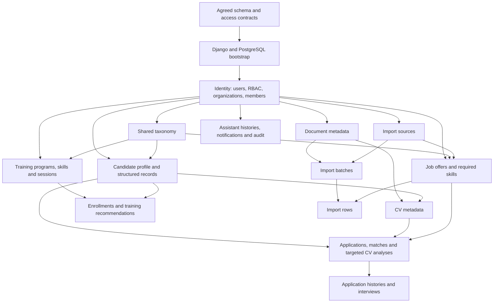
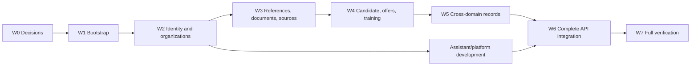

# Phase 01 — Data model becomes a usable backend

Status: execution in progress. The P1 Django and identity/RBAC code is implemented,
but its initial migration and PostgreSQL integration remain gated on P4's organization
models. Other task rows remain plans until their owners implement them. Read the
[full roadmap](implementation_roadmap.md) and [team workflow](development_workflow.md).

## Authority, scope and completion

Sources: [logical data model](../../mahara_match_data_modeling.md) (DM §§1–7, 9),
[specification](../../Cahier%20de%20charge%20pr%C3%A9liminaire%20PDF.pdf)
(PDF physical pp. 3–10), [context](../../CONTEXT.md) and
[domain boundaries](../architecture/domain_boundaries.md).
The requested `Data modeling.md` is the existing `mahara_match_data_modeling.md`.
PDF pages include the cover. User decisions override conflicting source wording:
the ANETI advisor is the system AI agent (Q22), and deployment is a modular monolith (Q01).

Phase 1 covers **all 43 identified logical entities**, including the source's
diagram-only `skill_aliases`. Missing definitions are decision gates, not permission
to invent columns. Reporting, community and guidance have no approved additional
entities. A gate must be resolved before the affected model or operation is merged;
unblocked work may proceed, but incomplete entities cannot be reported as a complete Phase 1.

Deliver Django, DRF, ORM-managed PostgreSQL schema, basic serializers/services,
appropriate GET/POST/PUT/PATCH/DELETE routes, validation, access checks and real tests.
Do not implement OCR, matching computation, agents, imports, publication/submission
workflows or other advanced operations in this phase. Their data structures are
prepared now; execution belongs to the later roadmap phases.

API → application service → Django ORM → PostgreSQL applies to reads and writes.
No alternative SQL schema or direct serializer save path bypasses service validation.
The API and service must enforce the same ownership and authorization contracts.

## Team summary and task contracts

| Phase | Objective | Person 1 | Person 2 | Person 3 | Person 4 | Person 5 | Main areas | Deliverable |
| --- | --- | --- | --- | --- | --- | --- | --- | --- |
| 1 | All defined data domains available through controlled backend interfaces | Identity/RBAC, assistant/platform records, backend integration | Candidates, taxonomy, documents | Recruitment and persisted matches | Organizations, import records, PostgreSQL/CI | Training and taxonomy test support | backend/, tests/, infrastructure/postgres/, .github/workflows/ | Migrated PostgreSQL database, documented API contract and passing checks |

| Task ID | Accountable person and responsibility | Dependencies | Deliverable / validation | Required reviewer | Merge wave |
| --- | --- | --- | --- | --- | --- |
| P01-1A | P1: Django/DRF initialization, settings, identity/auth decision implementation, shared API contract and test setup | G01–G03 decisions below; P4 database connection | Django checks run against real PostgreSQL; test settings and user model configured before initial migrations | P4 | W1–W2 |
| P01-1B | P1: users/RBAC plus assistant/platform persistence and permitted interfaces | Identity organization scope from P4; privacy and record-access decisions | Identity constraints, privilege-escalation rejection, owned conversation reads and protected system records tested | P4; P2 for user/profile contract | W2, W6 |
| P01-2 | P2: taxonomy, documents and all candidate records | User identity; shared scales; document and candidate decisions; offers for targeted CV analyses | Candidate ownership, relationship integrity, primary-CV uniqueness, date/score bounds and API validation tested | P5; P3 for offer reference | W3–W5 |
| P01-3 | P3: offer/recruitment models and persisted matches | Organizations/users; taxonomy; import source; candidates/CVs; offer decisions | Offer constraints, duplicate application prevention, CV ownership and protected histories/results tested | P2; P4 for source/organization contract | W4–W5 |
| P01-4A | P4: organizations, memberships and import provenance records | P1 user/auth contract; source semantics; documents; offers for import rows | Hierarchy/member isolation and import foreign-key/uniqueness tests pass | P1; P3 for offer links | W2–W5 |
| P01-4B | P4: PostgreSQL development setup and CI integration | Runtime dependency contract with P1 | Repeatable clean PostgreSQL setup and CI migration/API test run; no hand-authored relational DDL | P1 | W1, W7 |
| P01-5 | P5: training models and permitted interfaces; support taxonomy consumer tests | Provider organization; shared skills; candidates for enrollment/recommendations; training decisions | Provider scope, date/score constraints and unique session/candidate enrollment tested | P4; P2 for candidate/taxonomy contract | W3 support, W4–W5 |

Each owner implements the model, serializer, service, API, permissions and tests
for their listed entities. P5's taxonomy assistance is limited to
`tests/integration/test_taxonomy_consumers.py`; P2 retains taxonomy model/API ownership.
P4 assists integration through PostgreSQL/CI files; P1 retains backend root configuration.
No assignment authorizes unrelated cross-module edits.

## Exact entity and file assignments

All paths in this section are **future paths**. The entity inventory below is the
single owner register for Phase 1. Source spellings identify logical concepts;
`Certifications` maps to the `certifications` Python filename without changing its meaning.

For each inventory row, expand its `domain/stem` value using this fixed file contract:

| Concern | Exact path rule |
| --- | --- |
| Model | `backend/apps/{domain}/models/{stem}.py` |
| Serializer | `backend/apps/{domain}/api/{stem}_serializers.py` |
| Service | `backend/apps/{domain}/services/{stem}.py` |
| API adapter | `backend/apps/{domain}/api/{stem}_views.py` |
| Permission adapter | `backend/apps/{domain}/api/{stem}_permissions.py` |
| Model/service tests | `tests/unit/backend/{domain}/test_{stem}.py` |
| PostgreSQL/API tests | `tests/integration/{domain}/test_{stem}_api.py` |

For example, `identity/organizations` assigns P4
`backend/apps/identity/models/organizations.py`,
`backend/apps/identity/api/organizations_serializers.py`,
`backend/apps/identity/services/organizations.py`,
`backend/apps/identity/api/organizations_views.py`,
`backend/apps/identity/api/organizations_permissions.py`,
`tests/unit/backend/identity/test_organizations.py`, and
`tests/integration/identity/test_organizations_api.py`.
The same expansion fixes every row's paths; no new app names are implied.
Unit cases remain database-independent; ORM tests use PostgreSQL in integration tests.
Restricted system-record APIs need read serializers/views only; do not create unused
write serializers or empty permission classes merely to satisfy the path convention.

### Operation key

This matrix is a **planned exposure contract**, subject to the named decision gates,
not a claim that unresolved permissions are already specified by the sources.

- **E**: editable resource; scoped GET, POST and PUT/PATCH for permitted fields.
  DELETE only after the approved retention/reference policy allows it.
- **L**: relationship management; scoped GET and service-mediated attach/update/remove.
  Use POST/PUT/PATCH/DELETE only where the approved relationship policy permits them.
- **R**: scoped read interface; creation/update only through authorized internal services
  or controlled synthetic fixtures in Phase 1. No generic public writes/deletes.
- **G**: governance resource; authenticated reads and administrator/explicitly authorized
  configuration writes according to the approved permission matrix, never self-granted privileges.

Every ID, timestamp, actor attribution and system-owned result is protected from
caller spoofing. Status changes are not ordinary arbitrary PATCH operations.
Every DELETE cell is gated: reference protection, logical deletion and retention
must be agreed; the source does not authorize blanket hard-delete cascades.

| Entity | Owner / task | Domain/stem (model and companion files) | Wave | Operations / access and protected state | Gate / later behavior |
| --- | --- | --- | --- | --- | --- |
| users | P1 / P01-1B | identity/users | W2 | E: own permitted profile fields; account administration via approved authority; credentials/roles/status never ordinary editable fields | G01–G03; account workflows P02-1 |
| roles | P1 / P01-1B | identity/roles | W2 | G: role definitions; no self-assignment | G01, G03 |
| permissions | P1 / P01-1B | identity/permissions | W2 | G: permission definitions and code uniqueness | G01, G03 |
| user_roles | P1 / P01-1B | identity/user_roles | W2 | L/G: privileged assignment with global/organization scope validation | G01–G03 |
| role_permissions | P1 / P01-1B | identity/role_permissions | W2 | L/G: privileged grants only | G01–G03 |
| organizations | P4 / P01-4A | identity/organizations | W2 | E: approved organization scope; verification state protected | G02–G03; verification/hierarchy workflows P02-4 |
| organization_members | P4 / P01-4A | identity/organization_members | W2 | L/G: authorized member administration; no self-escalation or arbitrary status transition | G01–G03; invitation lifecycle P02-4 |
| skills | P2 / P01-2 | taxonomy/skills | W3 | G: canonical shared reference, no candidate-owned duplicate | G04 |
| skill_aliases | P2 / P01-2 | taxonomy/skill_aliases | W3 | G: approved alias mapping; definition absent from dictionary | G04 |
| languages | P2 / P01-2 | taxonomy/languages | W3 | G: shared reference | G04 |
| education_levels | P2 / P01-2 | taxonomy/education_levels | W3 | G: shared levels and ordering; no invented equivalence rules | G04 |
| documents | P2 / P01-2 | documents/documents | W3 | E: owner-scoped metadata operations only; storage URI/integrity/scan attributes trusted-service managed | G03, G05; binary uploads P03-4 |
| candidate_profiles | P2 / P01-2 | candidates/candidate_profiles | W4 | E: candidate-owned fields; user link/derived completion protected; recruiter reads gated | G03–G05; completeness P02-2 |
| experiences | P2 / P01-2 | candidates/experiences | W4 | E: candidate-owned dated history | G03, G05 |
| educations | P2 / P01-2 | candidates/educations | W4 | E: candidate-owned education referencing shared levels | G03–G05 |
| candidate_languages | P2 / P01-2 | candidates/candidate_languages | W4 | L: own profile + shared language; approved level values | G02–G04 |
| candidate_skills | P2 / P01-2 | candidates/candidate_skills | W4 | L: own profile + canonical skill; validation/source provenance not caller-controlled | G02–G05 |
| Certifications | P2 / P01-2 | candidates/certifications | W4 | E: candidate-owned certification record; no invented training certificate issuance | G03, G05 |
| candidate_preferences | P2 / P01-2 | candidates/candidate_preferences | W4 | E: own approved preferences; cardinality and mobility unresolved | G05 |
| projects | P2 / P01-2 | candidates/projects | W4 | E: candidate-owned project record | G03, G05 |
| cvs | P2 / P01-2 | candidates/cvs | W4 | E: owned document reference and allowed metadata; version/parse outputs protected; primary selection enforces uniqueness | G03, G05; parsing/generation P03-2 |
| cv_analysis_results | P2 / P01-2 | candidates/cv_analysis_results | W5 | R: authorized analysis reads; scores/issues/suggestions produced internally | G05–G06; analysis P03-3 |
| data_sources | P4 / P01-4A | imports/data_sources | W3 | G: privileged source configuration; authorization not granted by arbitrary is_authorized input | G03, G08; authorization policy P06-1 |
| import_batches | P4 / P01-4A | imports/import_batches | W3 | R: operator-scoped reads; counters/checksums/status internally managed | G08; execution P06-4 |
| job_offers | P3 / P01-3 | recruitment/job_offers | W4 | E: authorized organization-owned draft metadata; publication/expiry/source attribution protected | G03, G06, G08; publication P02-3 |
| offer_skills | P3 / P01-3 | recruitment/offer_skills | W4 | L: offer scope + canonical skills; approved levels/importance | G02, G04, G06 |
| applications | P3 / P01-3 | recruitment/applications | W5 | R: candidate/authorized recruiter reads; no CRUD shortcut to submission or status transitions | G03, G07; submit/withdraw P05-3 |
| application_status_history | P3 / P01-3 | recruitment/application_status_history | W5 | R: scoped history reads; append through owning transition service only | G03, G07; transitions P05-3 |
| interviews | P3 / P01-3 | recruitment/interviews | W5 | R: scoped reads; scheduling/feedback writes require lifecycle permissions | G03, G07; basic workflow P05-3 |
| offer_matches | P3 / P01-3 | matching/offer_matches | W5 | R: scoped results; score/explanation/version computed internally | G03, G06; computation P04-3 |
| import_rows | P4 / P01-4A | imports/import_rows | W5 | R: operator-scoped provenance; linked offer and processing outcome internal | G08; ingestion P06-4 |
| training_programs | P5 / P01-5 | training/training_programs | W4 | E: authorized provider-owned catalogue metadata; lifecycle state protected | G03, G09; catalogue P02-5 |
| training_skills | P5 / P01-5 | training/training_skills | W4 | L: provider-owned program + shared skill | G02, G04, G09 |
| training_sessions | P5 / P01-5 | training/training_sessions | W4 | E: authorized provider session metadata; lifecycle rules gated | G03, G09; lifecycle P05-5 |
| training_enrollments | P5 / P01-5 | training/training_enrollments | W5 | R: authorized participant/provider reads; enrollment/progression writes internal | G03, G09; enrollment P05-5 |
| training_recommendations | P5 / P01-5 | training/training_recommendations | W5 | R: authorized results; score/reason/version internal | G03, G09; recommendations P04-5 |
| conversations | P1 / P01-1B | assistant/conversations | W6 | E: own container/title metadata; status changes gated | G03, G10; dialogue P08-4 |
| conversation_messages | P1 / P01-1B | assistant/conversation_messages | W6 | R: owned conversation history; no sender/citation spoofing or history overwrite | G03, G10; message submission P08-4 |
| agent_executions | P1 / P01-1B | assistant/agent_executions | W6 | R: permitted execution summaries; internal traces protected | G03, G10; execution P08-1 |
| agent_tool_calls | P1 / P01-1B | assistant/agent_tool_calls | W6 | R: permitted/redacted trace views; inputs/status internal | G03, G10; execution P08-1 |
| agent_actions | P1 / P01-1B | assistant/agent_actions | W6 | R: own permitted action summaries; cannot PATCH confirmed/executed timestamps | G03, G10; confirmation P08-1 |
| notifications | P1 / P01-1B | platform/notifications | W6 | R plus owner-only mark-read PATCH; recipients/content generated internally | G03, G10; delivery P05-1 |
| audit_logs | P1 / P01-1B | platform/audit_logs | W6 | R: privileged audit reads; no public create/update/delete | G03, G10; lifecycle audit P02-1 onward |

The table's R records remain usable through authorized read interfaces and tested
internal persistence; no dummy production generators are introduced. Gate decisions
must define who can see detailed versus redacted records before those views are exposed.

## Shared files, API contracts and things not to edit

P1 owns future `backend/manage.py`, `backend/config/settings/base.py`,
`backend/config/settings/development.py`, `backend/config/settings/test.py`,
`backend/config/urls.py`, `backend/config/asgi.py`, `backend/config/wsgi.py`,
`tests/conftest.py`, and runtime changes in `pyproject.toml` / `uv.lock`.
P1 coordinates any justified technical base in `backend/common/models.py`;
it may contain abstract timestamps/identity helpers after G02, never shared business tables.
P4 owns future `infrastructure/docker/compose.development.yaml`,
`infrastructure/postgres/README.md` and `.github/workflows/ci.yaml`.
Database setup uses Django migrations, not initialization SQL tables.

For each implemented app the owner adds `apps.py`, package markers,
`models/__init__.py`, `api/urls.py`, and `migrations/` when Django actually begins.
P1 integrates these shared files for identity; P4 submits organization/member
exports and routes in a small coordinated PR instead of editing them concurrently.
All owners use fully qualified backend app imports; do not put backend/apps on
the import path (its platform domain is not Python's standard-library platform module).

P1 publishes a reviewed API contract before domain API work: route names/versioning,
pagination, error representation, JWT authentication context, owner/organization
scope, service inputs/results, writable fields and method availability. P2–P5 review
their consumer contracts. G01 approves the authentication direction but does not
silently choose these remaining transport details or routes.

Shared relationships use canonical identifiers and agreed model references, never
copied tables or temporary shadow models. Services validate referenced ownership;
passing a UUID is not authorization. Cross-domain reads also use owning services.
Migrations use Django's dependency mechanism, including the approved user-model
dependency; implementers do not hardcode another developer's migration number.

Do not edit another owner's model/API/test files, root settings, dependency files,
shared exports or migration branch without coordination. A contract PR precedes
dependent feature PRs. Each domain PR includes its tests and API documentation;
P1 merges root registrations after it passes, not all five developers independently.

## Decision gates before coding the affected part

Question references point to the [question register](../architecture/open_questions.md).
The decisions below were approved by the user on **2026-09-21**. They replace the
previous undecided direction for G01–G10. Ownership still does not authorize inventing
concrete enum members, limits, transition rules or retention periods that the approved
decision does not state. Those details must be written into the owning schema/API
contract before the affected implementation.

| Gate | Approved decision (2026-09-21) | Owner; reviewers | Affected tasks | Required follow-through before coding |
| --- | --- | --- | --- | --- |
| G01 | Use Django `AbstractUser` with the custom `roles`, `permissions` and `user_roles` RBAC tables. Authenticate API access with JWT. Do not create a human ANETI role. Retain platform roles for Candidate, Employer, Training Organization, Ministry and Admin. | P1; P4, P2 | P01-1A, P01-1B, P01-4A; all API tasks | P1 publishes the role identifiers, JWT lifecycle and shared API/service contract before user migrations and route work. |
| G02 | Use UUID primary keys, `created_at` and `updated_at` on every persisted entity, explicit foreign keys and explicit `on_delete` rules. Represent organization hierarchy with `parent_id`. | P1; P4, P2, P3, P5 for their relations | All P01 model tasks | Each owner records its exact foreign-key deletion behavior and scoped uniqueness; P1 records global versus organization-scoped role uniqueness. |
| G03 | Define the RBAC matrix before exposing APIs. Users may access only resources allowed by their role and organization. Prefer soft deletion for important business records and protect system and audit fields. | P1; all domain owners | All P01 APIs and models with deletion semantics | Publish the resource/operation matrix, candidate visibility rules and the exact records subject to soft deletion or retention. No provisional unrestricted endpoints. |
| G04 | Use central reference tables for skills, languages and degrees, with alias tables. Enforce association uniqueness such as `(candidate, skill)`. | P2; P3, P5 | P01-2, P01-3, P01-5 | P2 publishes canonical table naming, alias shape, reference governance and the actual approved level/scale vocabularies before taxonomy migrations. |
| G05 | Store candidate preferences separately, covering work mode, relocation and location/distance. Support multiple CV versions. Store raw CV analysis separately from candidate-validated normalized data. | P2; P3, P1 | P01-2 | P2 records preference cardinality, distance semantics, CV/document cardinality, version allocation and concrete document/CV status vocabularies before candidate/document migrations and serializers. |
| G06 | Job offers contain salary minimum/maximum and currency, a URL, required languages through relationship tables, and controlled contract, work-mode and status enums. | P3; P2, P4 | P01-3; P01-2 targeted analyses | P3 publishes concrete enum values, language-level semantics, salary validation and URL constraints before offer/result models. |
| G07 | Use explicit application-status and interview-status enums. Preserve application/interview history instead of overwriting important transitions. | P3; P1, P2 | P01-3 | P3 publishes the concrete enum values, permitted transitions, authority, withdrawal/reapplication behavior and history retention before these models and write services. |
| G08 | Give every source an identifier, authorization status and configuration. Preserve import provenance with `source_id + external_id`, checksums and batch tracking. | P4; P3, P1 | P01-4A, P01-3 | P4 defines authorization governance, missing external-ID behavior, repeat/update semantics and concrete import/source statuses before source/import migrations. |
| G09 | Training uses controlled type, modality and status fields and pricing through `is_free` and price. Required and acquired skills reference the central skill tables. | P5; P4, P2 | P01-5 | P5 publishes concrete enums, price/currency constraints and the scope of prerequisites, assessment, attendance and certificates before training migrations. |
| G10 | Define controlled enums for messages, executions, actions and notifications. Retain execution/audit traces with user attribution. Important audit records are not normally deletable. | P1; P4, P2 | P01-1B | P1 publishes concrete enum values, trace visibility/redaction, protected lifecycle rules and the confirmation state machine before assistant/platform migrations. |

A field present in the logical model is not automatically fully specified. Explicitly
reconcile absent lengths/nullability/defaults, string enums without vocabularies,
unique/relationship cardinalities, score semantics, educational years vs date checks,
document-to-CV cardinality and CV numbering before the relevant migration. Do not
invent a generic OTHER status or guessed defaults to make the schema compile.

## Dependencies, parallel work and merge waves



The assistant message/execution links in DM §3.2 are within one app but still need
a deliberate dependency sequence: conversation/message definitions first, execution
links next, and any reverse link only as defined by the approved mapping. Do not
introduce duplicate links merely to copy both arrows of the diagram.

| Wave | PR order and parallel lanes | Coordination / conflict hotspot | Acceptance before dependent work |
| --- | --- | --- | --- |
| W0 | Decision/contract PRs first; all five review relevant gates | Model names, IDs, scopes, nullability and initial API contract | Blocking decisions recorded; every entity assigned |
| W1 | P1 backend/dependencies/test scaffold and P4 PostgreSQL/CI may develop together; merge compatible bootstrap as one reviewed integration | pyproject.toml, uv.lock, settings, shared fixtures | Django system check and a real PostgreSQL smoke test pass |
| W2 | P1 identity and P4 organizations use separate files; P1 serializes identity migrations and exports | identity/models/__init__.py, identity/api/urls.py, migrations | User/org/RBAC references valid; scope isolation verified |
| W3 | P2 taxonomy/documents and P4 source/batch records parallel; P5 consumer test support | Taxonomy vocabulary and raw_document_id references | Shared identifiers/types stable; document-dependent batches merge after metadata |
| W4 | P2 candidate/CV, P3 offers/skills and P5 program/session records parallel | Shared reference changes go back to owner; no copied enums/models | Domain constraints and scoped CRUD pass |
| W5 | P3 applications/matches, P2 target-offer analyses, P4 import rows and P5 enrollments/recommendations parallel | CV/offer references, same-app migration numbering within each lane | All cross-domain references valid; duplicate and ownership tests pass |
| W6 | P1 assistant/platform and root API integration; independent assistant work can start after W2 | Root routing, trace policy, shared integration fixtures | Controlled read/write interfaces cover all approved entities |
| W7 | P4 runs full CI; all owners fix their failures; P1 integrates migration/API contract | Final migration graph and shared configuration | Complete Phase 1 exit checklist passes |



In particular, `imports.data_sources` must precede `recruitment.job_offers`;
`imports.import_rows` follows offers. This breaks the apparent app-level cycle
without changing entity ownership. Do not make imports wait for a single migration
containing every recruitment entity, or vice versa. Generate staged migrations
from the latest integrated branch, with explicit Django dependencies and no assumed filenames.

## Required validation and exit criteria

Each domain supplies synthetic fixtures and tests for allowed operations, invalid
values, foreign-key ownership, unauthorized access, protected writes and approved
deletion behavior. No real CVs or secrets enter fixtures. Permission tests cover
both list filtering and detail lookup, service calls and API calls, another candidate,
another organization, anonymous requests and attempted role escalation.

Specific source requirements (DM §7) need PostgreSQL-backed tests:

- Case-insensitive email uniqueness; one profile per user; agreed association keys.
- One candidate/offer application, one candidate/session enrollment, at most one
  primary CV per candidate; include concurrent-write tests where races could bypass checks.
- Valid date/year ranges, salary ordering/currency and applicable score bounds.
- Offer/source identifier uniqueness under the approved missing-ID policy.
- CV belongs to the submitting candidate; links cannot cross an unauthorized tenant.
- Publication needs organization/title/description/at least one skill: Phase 1 must
  not expose a status PATCH that bypasses this Phase 2 service rule.
- System-record updates and spoofed attribution are rejected; application histories
  and audit records cannot be overwritten through CRUD.
- User/offer deletion with application history follows the approved logical-deletion
  rule; approved nullable/reference behavior is tested for every relationship.

At W7 run the following future commands, after the listed Django files exist:

```bash
uv sync --locked
uv run --frozen python backend/manage.py check --settings=backend.config.settings.test
uv run --frozen python backend/manage.py makemigrations --check --dry-run --settings=backend.config.settings.test
uv run --frozen python backend/manage.py migrate --noinput --settings=backend.config.settings.test
uv run --frozen ruff check .
uv run --frozen ruff format --check .
uv run --frozen mypy .
uv run --frozen pytest
```

P1's bootstrap must make the documented invocation/import path work from the root
and configure pytest's real Django test settings. Tests use isolated disposable
PostgreSQL databases; P4 verifies both a clean migration and an upgrade from the
previous integrated schema, plus no pending model changes. Do not reset a shared
database to hide a migration conflict. Coverage is reviewed for constraints and
permission paths; no arbitrary percentage substitutes for behavior tests.

Completion means 43 entities reconciled and implemented, approved interfaces
documented, no unresolved schema/access blocker for a shipped interface, CI green,
no unintended migrations, and one tested cross-domain fixture journey connecting
user → organization → offer and user → candidate → CV → application / training.
This fixture proves relational integration, not implemented application workflows.
Once implementation begins, pytest collecting zero tests is a failure of this phase.

Next: Phase 2 implements real user-facing operations through these services; later
phases compute results and populate protected records. Phase 1's existence alone
does not mean matching, recruitment workflows or the ANETI AI advisor are functional.
