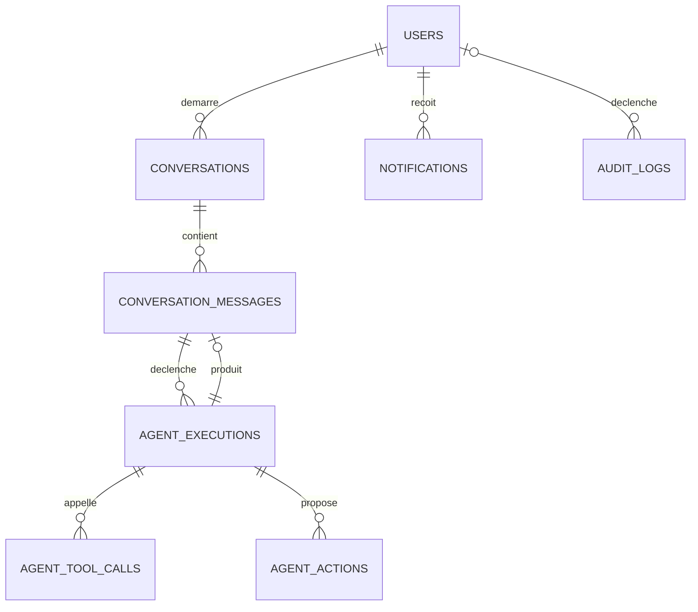
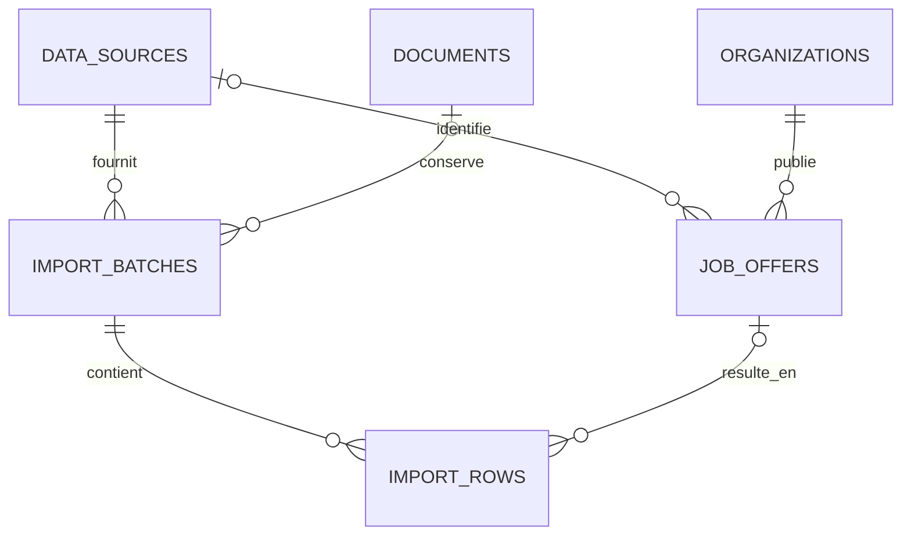

# data modeling

# **Mahara Match — Modèle de données logique (MVP)**

## **1. Principes de modélisation**

- **PostgreSQL est la source de vérité** pour les comptes, profils, offres, candidatures, formations et historiques.
- Un acteur est représenté par un **utilisateur**, un ou plusieurs **rôles** et, si nécessaire, une appartenance à une **organisation**.
- Les fichiers (CV, attestations, logos) sont conservés dans un **stockage objet** ; PostgreSQL ne garde que leurs métadonnées et leur URI.
- La base vectorielle et Neo4j sont des **index dérivés** de PostgreSQL. Ils servent à la recherche, au matching et à GraphRAG, mais ne remplacent pas les données transactionnelles.
- Les clés primaires sont des `UUID`. Toutes les tables métier possèdent au minimum `created_at` et `updated_at`.
- La suppression logique utilise `deleted_at` lorsque les données doivent rester auditables.

## **2. Acteurs et représentation dans la base**

| Acteur | Représentation | Données spécifiques |
| --- | --- | --- |
| Chercheur d’emploi | `users` + rôle `CANDIDATE` | `candidate_profiles`, CV, compétences, expériences, formations suivies et candidatures |
| Employeur / Recruteur | `users` + rôle `RECRUITER` + `organization_members` | Entreprise représentée par `organizations`; offres et entretiens créés par l’utilisateur |
| Organisme de formation | `users` + rôle `TRAINING_MANAGER` + `organization_members` | Organisation de type `TRAINING_PROVIDER`, programmes et sessions |
| Agent ANETI | `users` + rôle `ANETI_AGENT` + `organization_members` | Affectations et accompagnement des candidats |
| Responsable ministère | `users` + rôle `MINISTRY_MANAGER` + `organization_members` | Accès aux indicateurs agrégés et rapports |
| Administrateur | `users` + rôle `ADMIN` | Administration, contrôle et audit; aucun profil métier séparé nécessaire |

## **3. Vue relationnelle globale**

Le modèle est divisé en deux vues :

1. **Vue métier** : comptes, 
2. candidats, offres, candidatures et formations.

## 3.1 Vue relationnelle métier

```mermaid
erDiagram
    USERS ||--o{ USER_ROLES : possede
    ROLES ||--o{ USER_ROLES : attribue
    ROLES ||--o{ ROLE_PERMISSIONS : regroupe
    PERMISSIONS ||--o{ ROLE_PERMISSIONS : autorise

    USERS ||--o{ ORGANIZATION_MEMBERS : rejoint
    ORGANIZATIONS ||--o{ ORGANIZATION_MEMBERS : contient
    ORGANIZATIONS o|--o{ ORGANIZATIONS : parent_de

    USERS ||--o| CANDIDATE_PROFILES : possede

    CANDIDATE_PROFILES ||--o{ EXPERIENCES : declare
    CANDIDATE_PROFILES ||--o{ EDUCATIONS : declare

    CANDIDATE_PROFILES ||--o{ CANDIDATE_LANGUAGES : parle
    LANGUAGES ||--o{ CANDIDATE_LANGUAGES : reference

    CANDIDATE_PROFILES ||--o{ CANDIDATE_SKILLS : maitrise
    SKILLS ||--o{ CANDIDATE_SKILLS : reference
    SKILLS ||--o{ SKILL_ALIASES : normalise

    USERS ||--o{ DOCUMENTS : depose
    CANDIDATE_PROFILES ||--o{ CVS : possede
    DOCUMENTS ||--o| CVS : contient

    CVS ||--o{ CV_ANALYSIS_RESULTS : analyse
    JOB_OFFERS o|--o{ CV_ANALYSIS_RESULTS : cible

    ORGANIZATIONS ||--o{ JOB_OFFERS : publie
    USERS ||--o{ JOB_OFFERS : cree

    JOB_OFFERS ||--o{ OFFER_SKILLS : exige
    SKILLS ||--o{ OFFER_SKILLS : reference

    CANDIDATE_PROFILES ||--o{ APPLICATIONS : soumet
    JOB_OFFERS ||--o{ APPLICATIONS : recoit
    CVS ||--o{ APPLICATIONS : utilise

    APPLICATIONS ||--o{ APPLICATION_STATUS_HISTORY : historise
    APPLICATIONS ||--o{ INTERVIEWS : planifie

    CANDIDATE_PROFILES ||--o{ OFFER_MATCHES : obtient
    JOB_OFFERS ||--o{ OFFER_MATCHES : concerne

    ORGANIZATIONS ||--o{ TRAINING_PROGRAMS : propose
    TRAINING_PROGRAMS ||--o{ TRAINING_SKILLS : developpe
    SKILLS ||--o{ TRAINING_SKILLS : reference

    TRAINING_PROGRAMS ||--o{ TRAINING_SESSIONS : organise
    TRAINING_SESSIONS ||--o{ TRAINING_ENROLLMENTS : recoit
    CANDIDATE_PROFILES ||--o{ TRAINING_ENROLLMENTS : effectue

    TRAINING_PROGRAMS ||--o{ TRAINING_RECOMMENDATIONS : recommande
    CANDIDATE_PROFILES ||--o{ TRAINING_RECOMMENDATIONS : recoit
```



### Lecture du diagramme

Les principales relations sont :

- un utilisateur peut posséder plusieurs rôles ;
- une organisation peut contenir plusieurs membres ;
- une organisation peut avoir plusieurs filiales ;
- un utilisateur candidat possède un seul profil candidat ;
- un candidat peut posséder plusieurs CV ;
- un CV peut recevoir plusieurs analyses ;
- une organisation peut publier plusieurs offres ;
- un candidat peut postuler à plusieurs offres ;
- une candidature utilise une version précise du CV ;
- une candidature peut avoir plusieurs changements de statut et entretiens ;
- une organisation de formation peut proposer plusieurs programmes ;
- un candidat peut s’inscrire à plusieurs sessions de formation.

## 3.2 Vue relationnelle de l’agent IA



**Logique de l’agent IA**

```mermaid
Utilisateur
   └── Conversation
         └── Messages
               └── Exécution de l’agent
                     ├── Appels d’outils
                     └── Actions métier
```

## 3.3 Vue relationnelle des imports



**Logique d’import**

```mermaid
Source externe
   └── Lot d’import
         └── Lignes importées
               └── Offre ajoutée, actualisée ou rejetée
```

## **4. Dictionnaire des tables**

### **A. Identité, rôles et organisations**

#### **`users`**

Compte commun à tous les acteurs.

| Colonne | Type | Règle |
| --- | --- | --- |
| `id` | UUID | PK |
| `email` | VARCHAR(255) | UNIQUE, obligatoire |
| `password_hash` | TEXT | obligatoire pour une authentification locale |
| `first_name`, `last_name` | VARCHAR(100) | obligatoires |
| `phone` | VARCHAR(30) | facultatif |
| `status` | VARCHAR(20) | `PENDING`, `ACTIVE`, `SUSPENDED`, `DISABLED` |
| `email_verified_at` | TIMESTAMPTZ | facultatif |
| `last_login_at` | TIMESTAMPTZ | facultatif |

#### **`roles`, `permissions`, `user_roles`, `role_permissions`**

| Table | Colonnes principales | Contraintes essentielles |
| --- | --- | --- |
| `roles` | `id`, `code`, `name`, `description` | `code` UNIQUE |
| `permissions` | `id`, `code`, `resource`, `action` | `code` UNIQUE |
| `user_roles` | `user_id`, `role_id`, `organization_id`, `assigned_at` | PK (`user_id`, `role_id`, `organization_id`) |
| `role_permissions` | `role_id`, `permission_id` | PK (`role_id`, `permission_id`) |

`organization_id` peut être nul dans `user_roles` pour un rôle global, par exemple `ADMIN`.

`La logique utilisée s’appelle RBAC (Role-Based Access Control), c’est-à-dire : les autorisations sont accordées aux utilisateurs à travers leurs rôles.`

#### **`organizations`**

Représente une entreprise, une filiale, un organisme de formation, une structure ANETI ou le ministère.

| Colonne | Type | Règle |
| --- | --- | --- |
| `id` | UUID | PK |
| `parent_id` | UUID | FK vers `organizations.id`, facultatif pour les filiales |
| `type` | VARCHAR(30) | `COMPANY`, `SUBSIDIARY`, `TRAINING_PROVIDER`, `ANETI`, `MINISTRY` |
| `legal_name` | VARCHAR(255) | obligatoire |
| `registration_number` | VARCHAR(100) | facultatif, UNIQUE par pays |
| `description` | TEXT | facultatif |
| `website_url`, `logo_uri` | TEXT | facultatifs |
| `matricule_fiscal` | CHAR(13) | obligatoire, unique |
| `governorate`, `city`, `address_line` | VARCHAR | facultatifs |
| `verification_status` | VARCHAR(20) | `PENDING`, `VERIFIED`, `REJECTED` |

Il s’agit d’une clé étrangère autoréférentielle : elle pointe vers une autre ligne de la même table organizations.

Exemple:

id legal_name type parent_id

ORG-1 Groupe TelNet COMPANY NULL

ORG-2 TelNet France SUBSIDIARY ORG-1

ORG-3 TelNet Tunisia SUBSIDIARY ORG-1

#### **`organization_members (Recruiters)`**

| Colonne | Type | Règle |
| --- | --- | --- |
| `organization_id` | UUID | FK, partie de la PK |
| `user_id` | UUID | FK, partie de la PK |
| `job_title` | VARCHAR(150) | facultatif |
| `joined_at` | TIMESTAMPTZ | facultatif |

### **B. Profil candidat et CV Intelligence**

#### **`candidate_profiles`**

| Colonne | Type | Règle |
| --- | --- | --- |
| `id` | UUID | PK |
| `user_id` | UUID | FK vers `users`, UNIQUE |
| `birth_date` | DATE | facultatif et protégé |
| `country_code`, `governorate`, `city` | VARCHAR | facultatifs |
| `headline` | VARCHAR(200) | facultatif |
| `summary` | TEXT | facultatif |
| `employment_status` | VARCHAR(30) | facultatif |
| `desired_job_title` | VARCHAR(150) | facultatif |
| `availability_date` | DATE | facultatif |
| `profile_visibility` | VARCHAR(20) | `PRIVATE`, `RECRUITERS`, `PUBLIC` |
| `completion_score` | NUMERIC(5,2) | de 0 à 100 |
| Distance | NUMERIC(5,2) | the distance between the candidate and the job offer in KM(kilometre) |
| Relocation | ENUM (willing to relocate or no) | indique si le candidate peux changer sa place pour le travaille |

#### **Données structurées du candidat**

| Table | Colonnes principales | Rôle |
| --- | --- | --- |
| `experiences` | `id`, `candidate_id`, `organization_name`, `job_title`, `start_date`, `end_date`, `description` | Historique professionnel |
| `educations` | `id`, `candidate_id`, `education_level_id`, `institution`, `field_of_study`, `start_year`, `end_year`, `description` | Parcours académique |
| education_levels | `id`, `name`, `description`, `level_order` | Référentiel des niveaux de formation : Licence, Master, Diplôme d’ingénieur, Doctorat, etc. |
| `languages` | `id`, `code`, `name` | Référentiel des langues |
| `candidate_languages` | `candidate_id`, `language_id`, `level` | Niveau linguistique du candidat |
| `skills` | `id`, `canonical_name`, `category`, `description` | Référentiel normalisé des compétences |
| `candidate_skills` | `candidate_id`, `skill_id`, `level`, `years_experience`, `validated`, `source` | Compétences du candidat |
| Certifications | `id`, `candidate_id`, `name`, `description`, `certification_organization`, `issue_date`, `expiration_date`, `credential_id`, `credential_url`, `created_at`, `updated_at` | Stocker les certifications obtenues par un candidat, avec l’organisme délivreur et les informations de vérification. |
| candidate_preferences | `id`, `candidate_id`, `work_mode`, `created_at`, `updated_at` | Stocker la préférence du candidat concernant le mode de travail souhaité pour les offres : `REMOTE`, `HYBRID` ou `ONSITE`. |
| projects | `id`, `candidate_id`, `name`, `description`, `role`, `start_date`, `end_date`, `project_url`, `repository_url`, `technologies`, `created_at`, `updated_at` | Représenter les projets académiques, personnels ou professionnels réalisés par le candidat et valoriser ses compétences dans le matching. |

#### **`documents` et `cvs`**

| Table | Colonnes principales | Rôle |
| --- | --- | --- |
| `documents` | `id`, `owner_user_id`, `type`, `storage_uri`, `file_name`, `mime_type`, `size_bytes`, `checksum`, `scan_status`, `uploaded_at` | Métadonnées des fichiers stockés hors PostgreSQL |
| `cvs` | `id`, `candidate_id`, `document_id`, `title`, `language_code`, `is_primary`, `parse_status`, `parsed_data_json`, `version_number` | Version de CV importée ou générée |
| `cv_analysis_results` | `id`, `cv_id`, `target_offer_id`, `overall_score`, `issues_json`, `suggestions_json`, `analyzed_at` | Résultat reproductible d’une analyse ATS |

`parsed_data_json` conserve le résultat OCR/NLP brut ou semi-structuré; les informations validées par le candidat sont copiées dans les tables normalisées.

### **C. Offres et recrutement**

#### **`job_offers`**

| Colonne | Type | Règle |
| --- | --- | --- |
| `id` | UUID | PK |
| `organization_id` | UUID | FK vers l’entreprise |
| `created_by` | UUID | FK vers le recruteur |
| `source_id` | UUID | FK facultative vers `data_sources` |
| `external_id` | VARCHAR(255) | identifiant fourni par la source |
| `title` | VARCHAR(200) | obligatoire |
| `description` | TEXT | obligatoire |
| `contract_type`, `work_mode` | VARCHAR(30) | facultatifs |
| `country_code`, `governorate`, `city` | VARCHAR | facultatifs |
| `experience_level` | VARCHAR(30) | facultatif |
| `min_salary`, `max_salary` | NUMERIC(12,2) | facultatifs |
| `application_deadline` | DATE | facultatif |
| `status` | VARCHAR(20) | `DRAFT`, `PUBLISHED`, `PAUSED`, `CLOSED`, `ARCHIVED` |
| `published_at`, `closed_at` | TIMESTAMPTZ | facultatifs |
| offer_url | VARCHAR(50) | facultatifs |
| description_language | UUID | FK vers table language  |
| requiered_languages | UUID | FK vers table language  (this field is to know what langauge the CV gonna be) |
| education_level | UUID | FK → `education_levels.id` |
| Easy_apply | BOOLEAN | Gonna see if easy apply then the candidate or the agent can do the apply if not the candidate gonna make the apply external of the platform and with this the applciation,interviews tracking is not supported. |

Contrainte anti-doublon recommandée : UNIQUE (`source_id`, `external_id`) lorsque `external_id` est présent.

#### **Compétences, candidatures et entretiens**

| Table | Colonnes principales | Règle métier |
| --- | --- | --- |
| `offer_skills` | `offer_id`, `skill_id`, `importance`, `required_level`, `is_mandatory` | PK (`offer_id`, `skill_id`) |
| `applications` | `id`, `candidate_id`, `offer_id`, `cv_id`, `status`, `cover_letter`, `applied_at`, `withdrawn_at` | UNIQUE (`candidate_id`, `offer_id`) |
| `application_status_history` | `id`, `application_id`, `status`, `reason`, `changed_at` | Trace chaque changement d’état |
| `interviews` | `id`, `application_id`, `scheduled_by`, `type`, `scheduled_at`, `duration_minutes`, `location_or_url`, `status`, `feedback` | Entretien lié à une candidature |
| `offer_matches` | `id`, `candidate_id`, `offer_id`, `model_version`, `overall_score`, `skill_score`, `experience_score`, `location_score`, `explanation_json`, `calculated_at` | UNIQUE (`candidate_id`, `offer_id`, `model_version`) |

États proposés pour `applications.status` : `SUBMITTED`, `UNDER_REVIEW`, `PRESELECTED`, `INTERVIEW`, `OFFERED`, `HIRED`, `REJECTED`, `WITHDRAWN`.

### **D. Formations**

| Table | Colonnes principales | Rôle |
| --- | --- | --- |
| `training_programs` | `id`, `organization_id`, `title`, `description`, `level`, `delivery_mode`, `status` | Catalogue d’un organisme |
| `training_skills` | `program_id`, `skill_id`, `target_level` | Compétences développées |
| `training_sessions` | `id`, `program_id`, `start_date`, `end_date`, `capacity`, `location_or_url`, `registration_deadline`, `status` | Occurrence planifiée d’une formation |
| `training_enrollments` | `id`, `session_id`, `candidate_id`, `status`, `enrolled_at`, `completion_rate`, `completed_at` | Inscription et progression |
| `training_recommendations` | `id`, `candidate_id`, `program_id`, `reason_json`, `score`, `model_version`, `created_at` | Recommandation explicable |

<aside>
✅

payant ou non

</aside>

Contrainte : UNIQUE (`session_id`, `candidate_id`) dans `training_enrollments`.

### **E. Agent IA, conversations, actions et audit**

| Table | Colonnes principales | Rôle |
| --- | --- | --- |
| `conversations` | `id`, `user_id`, `title`, `status`, `started_at`, `last_message_at` | Représente une conversation entre un utilisateur et l’agent IA |
| `conversation_messages` | `id`, `conversation_id`, `sender_type`, `content`, `intent`, `citations_json`, `created_at` | Conserve les messages de l’utilisateur, de l’agent et les sources utilisées |
| `agent_executions` | `id`, `request_message_id`, `response_message_id`, `route`, `status`, `agent_version`, `latency_ms`, `error_code`, `created_at` | Trace le traitement d’une demande par l’agent |
| `agent_tool_calls` | `id`, `execution_id`, `tool_name`, `input_json`, `output_summary_json`, `status`, `latency_ms`, `error_code`, `created_at` | Conserve chaque appel d’outil réalisé pendant une exécution |
| `agent_actions` | `id`, `execution_id`, `action_type`, `target_type`, `target_id`, `status`, `confirmed_at`, `executed_at`, `created_at` | Conserve les actions métier proposées, confirmées ou exécutées par l’agent |
| `notifications` | `id`, `user_id`, `type`, `title`, `body`, `payload_json`, `read_at`, `created_at` | Notifications envoyées à l’utilisateur |
| `audit_logs` | `id`, `actor_user_id`, `action`, `entity_type`, `entity_id`, `before_json`, `after_json`, `ip_address`, `created_at` | Historique des opérations sensibles réalisées par un utilisateur ou par l’agent |

### **F. Imports d’offres sans doublons**

| Table | Colonnes principales | Rôle |
| --- | --- | --- |
| `data_sources` | `id`, `name`, `type`, `base_url`, `is_authorized`, `configuration_json` | Source partenaire, fichier ou API |
| `import_batches` | `id`, `source_id`, `raw_document_id`, `checksum`, `status`, `started_at`, `completed_at`, `added_count`, `updated_count`, `unchanged_count`, `rejected_count` | Un traitement d’import |
| `import_rows` | `id`, `batch_id`, `row_number`, `external_id`, `payload_json`, `status`, `error_code`, `error_message`, `job_offer_id` | Traçabilité ligne par ligne |

`checksum` rend le lot identifiable; la paire (`source_id`, `external_id`) empêche la duplication des offres.

#### **1. data_sources : origine des offres**

Cette table représente la source externe qui fournit les offres.

| id | name | type | base_url | is_authorized |
| --- | --- | --- | --- | --- |
| `SRC1` | ANETI Open Data | `API` | `https://api.aneti.tn` | `true` |
| `SRC2` | Partenaire RH | `CSV` | `NULL` | `true` |
| `SRC3` | Entreprise ABC | `MANUAL_FILE` | `NULL` | `false` |

#### **2. import_batches : une opération d’import**

Un batch représente un traitement complet.

| id | source_id | checksum | status | added | updated | unchanged | rejected |
| --- | --- | --- | --- | --- | --- | --- | --- |
| `B1` | `SRC1` | `abc123...` | `COMPLETED` | 700 | 150 | 130 | 20 |

#### **3. import_rows : suivi ligne par ligne**

| row_number | external_id | status | error_code | job_offer_id |
| --- | --- | --- | --- | --- |
| 1 | `ANETI-1001` | `ADDED` | `NULL` | `JOB1` |
| 2 | `ANETI-1002` | `UPDATED` | `NULL` | `JOB2` |
| 3 | `NULL` | `REJECTED` | `MISSING_EXTERNAL_ID` | `NULL` |

## **5. Répartition par système de stockage**

| Système | Données conservées |
| --- | --- |
| PostgreSQL | Toutes les tables relationnelles définies ci-dessus |
| Stockage objet | CV PDF/image, attestations, logos et fichiers bruts d’import |
| Base vectorielle | Embeddings de CV, profils, offres, formations et organisations, avec leurs identifiants PostgreSQL |
| Neo4j | Relations projetées `CANDIDATE-SKILL`, `OFFER-REQUIRES_SKILL`, `TRAINING-DEVELOPS_SKILL`, `ORGANIZATION-PUBLISHES_OFFER` |

PostgreSQL reste la référence. Un changement validé y est enregistré en premier, puis synchronisé vers la base vectorielle et Neo4j via des jobs idempotents.

## **6. Relations et cardinalités essentielles**

| Relation | Cardinalité |
| --- | --- |
| Un utilisateur — rôles | N:N via `user_roles` |
| Une organisation — membres | 1:N via `organization_members` |
| Une organisation mère — filiales | 1:N via `organizations.parent_id` |
| Un candidat — CV | 1:N |
| Un candidat — compétences | N:N via `candidate_skills` |
| Une entreprise — offres | 1:N |
| Une offre — compétences | N:N via `offer_skills` |
| Un candidat — offres postulées | N:N via `applications` |
| Une candidature — historique | 1:N |
| Une candidature — entretiens | 1:N |
| Un organisme — programmes | 1:N |
| Un programme — sessions | 1:N |
| Un candidat — sessions suivies | N:N via `training_enrollments` |

## **7. Contraintes de cohérence prioritaires**

- Adresse e-mail unique sans tenir compte de la casse.
- Une seule candidature d’un candidat pour une même offre.
- Une seule inscription du candidat à une même session de formation.
- `end_date >= start_date` pour expériences, études, sessions et affectations.
- `max_salary >= min_salary` et devise obligatoire lorsqu’un salaire est défini.
- Scores compris entre 0 et 100.
- Une offre publiée doit posséder une organisation, un titre, une description et au moins une compétence.
- Un CV principal au maximum par candidat, garanti par un index unique partiel.
- Les transitions de statut des candidatures doivent être validées par le service métier et historisées.
- Les suppressions d’utilisateurs et d’offres doivent être logiques lorsqu’un historique de candidature existe.

## **9. Choix à valider avant le schéma SQL physique**

- Utiliser un fournisseur d’identité externe ou conserver `password_hash` localement.
- Définir les valeurs finales des niveaux de compétence et de langue.
- Fixer la durée de conservation des conversations, CV, journaux d’audit et données refusées à l’import.
- Décider quelles données personnelles sont visibles par les recruteurs avant qu’un candidat postule.
- Définir les transitions autorisées du workflow de candidature.